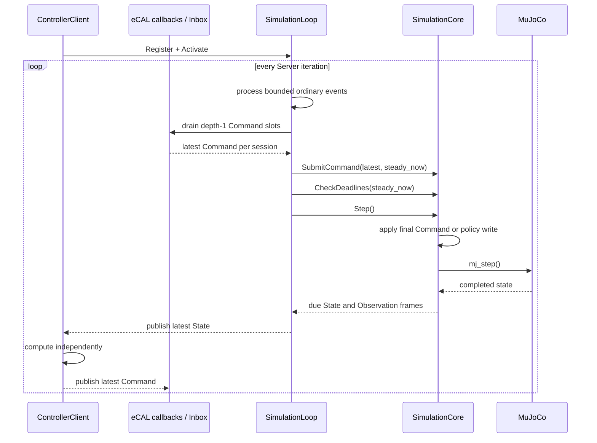

# Asynchronous Controller sequence

Commands A, B, and C arriving before one Step collapse to C. If none arrives,
the last ctrl value remains. Publisher send failure does not stop either side:
the SDK retries identical sequence/bytes, and the Server continues stepping.

Realtime pacing performs at most one Step per iteration and reanchors a wall
deadline when more than one period late. Unthrottled pacing handles events and
Inbox once, then performs one Step without waiting.
