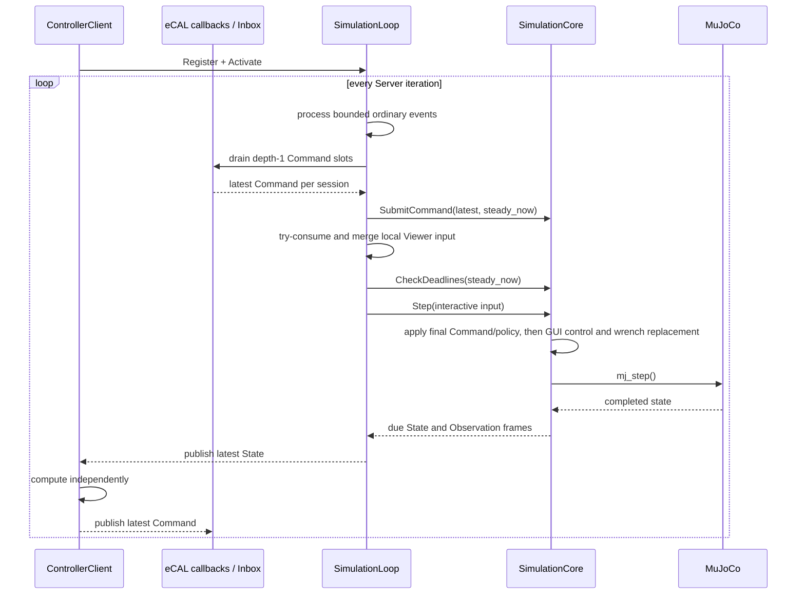

# Asynchronous Controller sequence

Commands A, B, and C arriving before one Step collapse to C. If none arrives,
the last ctrl value remains. An ordinary eCAL send rejection does not stop
either side: the SDK retries identical sequence/bytes, newer local generations
remain pending, and the Server continues stepping. Serialization, missing
endpoint, or eCAL exceptions are structured publication errors: the SDK makes
the Controller terminal and wakes subsequent State reads with `kError` instead
of retrying corrupted or unpublishable data indefinitely.

Local GUI Control writes are independently merged per actuator until one Step
completes. They are applied after Controller writes at the same boundary, but
are not persistent overrides: a later Command becomes the next writer. Viewer
mouse wrench frames are complete state replacements and expire from their
steady-clock generation time when synchronization stops.

SDK lifecycle admission is held across the logical operation but does not hold
a mutex across activation RPC, callback teardown, or publisher join. `Stop()`
sets cancellation before waiting for admission. If remote activation succeeds
but local publisher startup cannot commit, the client drains local work and
attempts compensating unregister; a failed cleanup remains explicitly retryable.

Realtime pacing performs at most one Step per iteration and reanchors a wall
deadline when more than one period late. Unthrottled pacing handles events and
Inbox once, then performs one Step without waiting.
