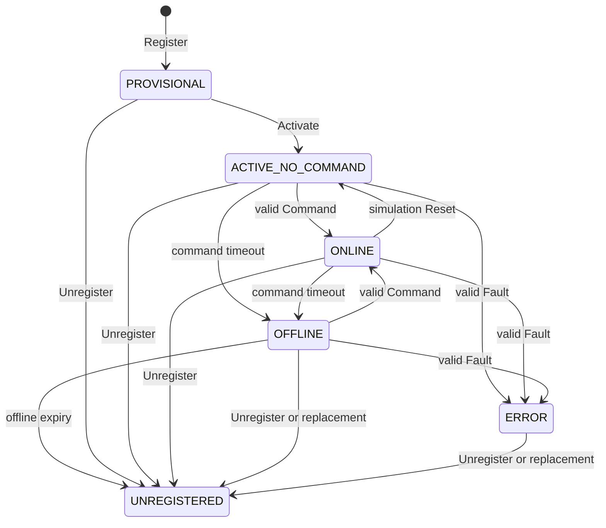

# Controller lifecycle

Activation starts Command liveness and anchors State cadence, but emits no
State. The first due frame comes from a completed Step. `ACTIVE_NO_COMMAND`,
`ONLINE`, and `OFFLINE` receive State; `ERROR` does not.

Command sequences are strictly increasing within a session. Structurally valid
but stale, duplicate, conflicting duplicate, non-finite, out-of-range, or
layout-invalid Commands are rejected without changing state or liveness. Only
a valid `ControllerFault` enters terminal `ERROR`.

Simulation Reset preserves every Controller session, frozen layout, resource
ownership, State sequence, and last accepted Command sequence. `PROVISIONAL`,
`ACTIVE_NO_COMMAND`, `OFFLINE`, and `ERROR` retain their lifecycle state;
`ONLINE` returns to `ACTIVE_NO_COMMAND`. All cached Commands are cleared and
zero control is applied until a new wire Command with a sequence strictly
greater than the preserved last sequence arrives. Active command liveness is
reanchored at Reset, while an `OFFLINE` Controller keeps its offline time,
timeout statistics, and diagnostic, and an `ERROR` Controller keeps its error
policy and diagnostic. The official SDK keepalive publisher continues to send
the latest value with increasing wire sequences, but custom clients must also
explicitly satisfy this sequence rule.

Control policy changes are deferred to the next Step boundary. Startup defaults
to `zero`, offline to `hold_last`, error to `zero`, and release to `zero`.
Optional offline expiry removes ownership. The Server publishes one
`UNREGISTERED` tombstone before deleting transport resources; clients also
treat disappearance of a previously seen session as terminal.
