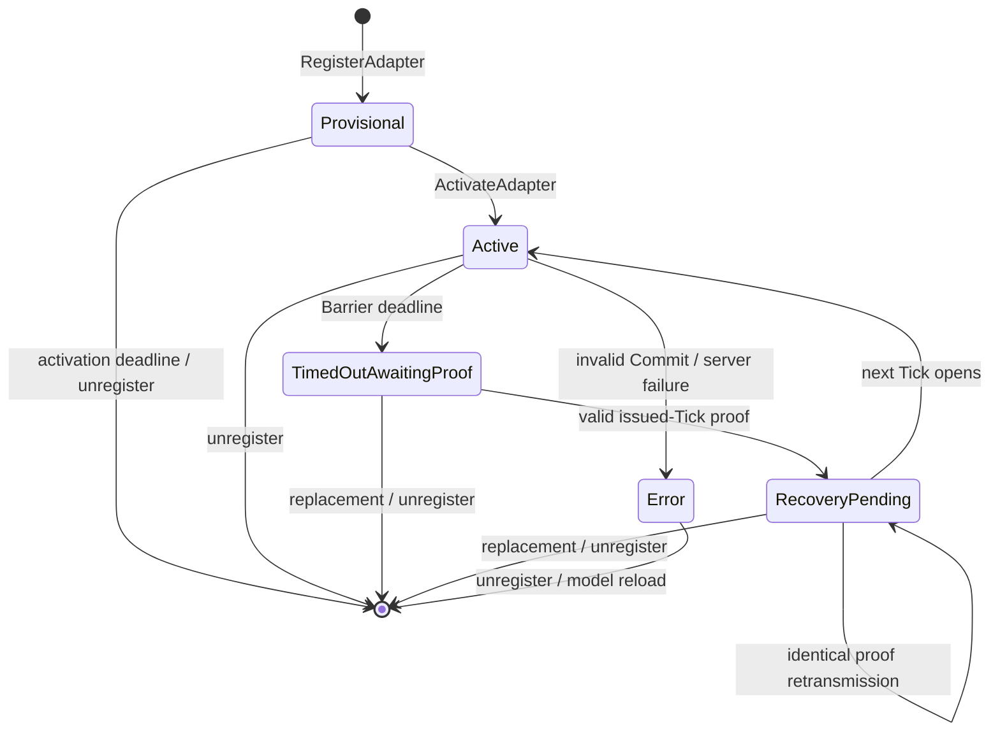
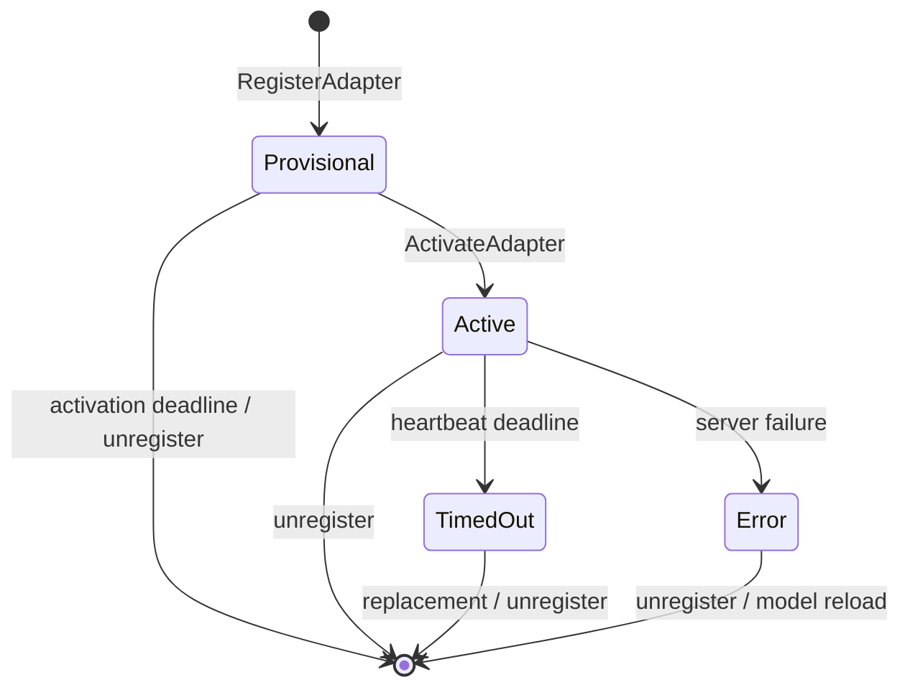

# Adapter lifecycle

`SimulationCore` stores explicit internal phases. Protocol V2
`ControllerState` values are projections only; production code changes a phase
through `ControllerStateMachine` or `ObserverStateMachine`.

## Controller

`TimedOutAwaitingProof` and `RecoveryPending` both project to `TIMED_OUT`.
Recovery proof validates the exact server, session, epoch, protocol version,
issued Tick range, Commit status, and full command shape. It stores an immutable
copy for duplicate verification but never joins the open Barrier and never
applies its command values. Only opening the next Tick changes
`RecoveryPending` to `Active`.

Barrier membership is frozen when a Tick opens. A newly activated or recovered
Controller joins the next Barrier. Deadline, unregister, or local error can
remove a required member from the current Barrier. If that removal makes the
Barrier ready, the same operation returns the one `StepCompletedEvent`.

Actuator ownership is acquired atomically with successful registration and is
released on unregister, activation expiry, replacement, or model reload. When
a Controller leaves while a Tick is open, zeroing is queued in the frozen
Barrier write plan; it is not written early. Outside an open Tick, controls are
zeroed immediately.

Timed-out replacement is permitted only when configured. It invalidates the
old Tick identity, queues or applies zeroing, releases old actuator ownership,
removes the old Barrier member, then installs a new provisional session. Any
server/session/epoch mismatch returns an error without mutation.

## Observer

Observers never join a Barrier and cannot own actuators. Activation records the
current Tick so an Observer cannot receive a frame for state produced before it
became active. Frame sequence is strictly increasing within a session. A
heartbeat refreshes liveness only when its exact identity and acknowledged
sequence are valid.

The transition acceptance matrix is executable in
`core/mujoco_sim_core/test/controller_state_machine_test.cpp`; cross-component
effects are covered by the Core lifecycle integration tests.
