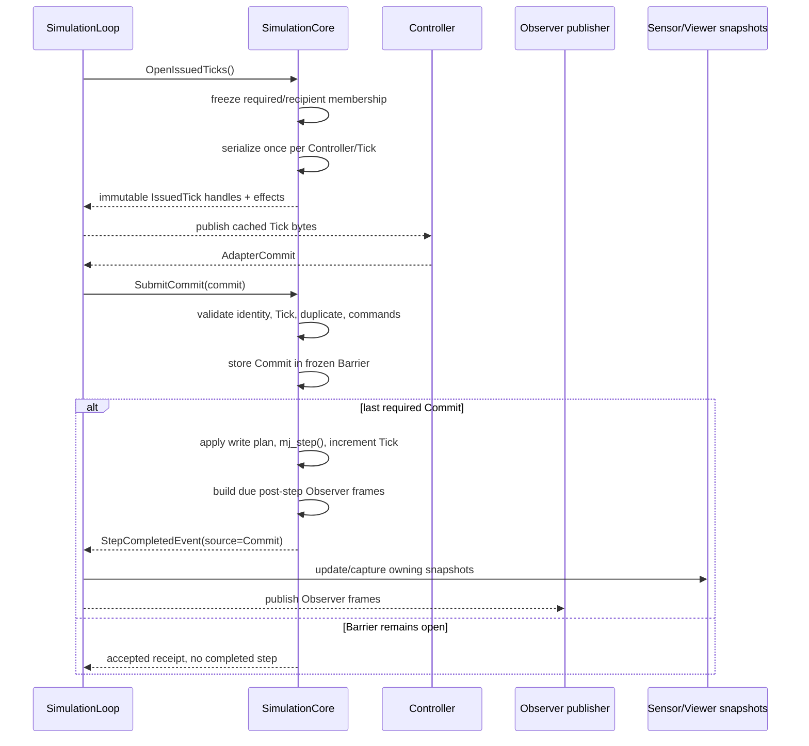

# Tick and Commit sequence

Only `SimulationLoop` invokes mutable `SimulationCore` methods. Every operation
returns its effects before transport publication, so Core state mutation and
external post-processing remain ordered without a Core mutex.

## Normal Barrier



Repeated `OpenIssuedTicks()` calls while the Barrier is open return the same
shared handles and cached bytes. A successful issue has
`serialization_count == 1`. Completion, unregister, replacement, model load,
failure, or stop invalidates identity lookup without destroying handles already
owned by a publisher.

## Timeout and recovery

```mermaid
sequenceDiagram
  participant L as SimulationLoop
  participant C as SimulationCore
  participant A as Timed-out Controller

  L->>C: CheckDeadlines(now)
  C->>C: Active -> TimedOutAwaitingProof
  C->>C: remove required member, queue zeroing
  C-->>L: TimedOut change + optional StepCompletedEvent
  L->>C: OpenIssuedTicks()
  C-->>A: immutable recovery Tick
  A-->>L: Commit matching issued Tick
  L->>C: SubmitCommit(proof)
  C->>C: validate/store proof; do not apply commands
  C-->>L: RecoveryPending change
  L->>C: OpenIssuedTicks() for next Barrier
  C->>C: RecoveryPending -> Active, then freeze membership
  C-->>L: Recovered change + new active Tick
```

An identical proof retransmission is idempotent. A proof with the same Tick but
different payload is a Controller-local error. Proof command values never enter
the actuator write plan.

## Other completion sources

- `Deadline`: timed-out required Controllers are removed; deferred zeroing is
  included in the same write plan before the step.
- `Unregister`: exact-session removal may make the current Barrier ready.
- `LocalError`: invalid Commit isolates that Controller and may complete the
  remaining Barrier.
- `EmptyBarrier`: the realtime loop explicitly completes an already-open
  Barrier with no required Controllers.

Each source returns at most one `StepCompletedEvent`; the Server processes all
five through `SimulationLoop::ApplyEffects()` and `ApplyCompletedStep()`.
