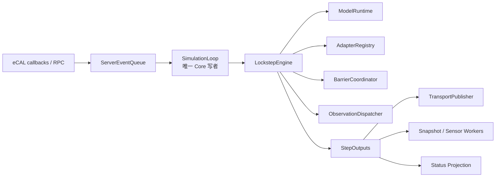

# mujoco_sim_core 可维护性分析与重构方案

> 分析对象：用户上传的 `mujoco_sim_core-main(1).zip`  
> 范围：排除仓库内随包提供的 MuJoCo 头文件、二进制和官方 simulate 相关源码；不讨论这些文件的硬链接或分发方式。

## 1. 结论

当前仓库并不是“完全没有架构”，相反，它已经按 `protocol / core / sensor / server / adapter_sdk / demos` 做了包级拆分，也拥有较多测试。真正的问题是：

1. 包级边界存在，但包内部仍由少数超级类和超级函数承担大部分职责；
2. server 允许多个线程入口直接修改 Core 并触发物理步进，导致同步逻辑复杂；
3. Core 直接使用 Protobuf 消息作为领域模型，并同时负责模型、资源、注册、所有权、Barrier、恢复、快照、状态投影；
4. Adapter SDK 的 Controller 和 Observer 重复实现了大量生命周期、服务调用、回调保护和等待队列逻辑；
5. 生产代码几乎没有代码级注释，公开 API 没有 Doxygen 契约；
6. 配置生成器、Observer、Sensor Stream、GUI、状态工具等能力同时进入主线，使“最小同步控制路径”不够突出。

因此，解决方案不应是重写，也不应只是给现有大文件补注释，而应按以下顺序处理：

1. 先建立文档、复杂度基线和行为保护；
2. 将 Server 改成单写者事件循环；
3. 将 Core 拆成真实协作对象，而不是同一 `.cpp` 内的公开字段容器；
4. 合并 SDK 公共生命周期实现；
5. 将 Observer、Sensor Stream、GUI 和配置生成器隔离成可选能力；
6. 最后再考虑协议文件拆分和内部结果类型改造。

---

## 2. 仓库现状

### 2.1 已有的合理设计

以下设计应保留：

- `mujoco_sim_core` 不直接依赖 eCAL，物理状态与传输层已具备基本隔离；
- Server 是真实 `mjModel/mjData` 的唯一所有者；
- actuator command 有独占所有权检查；
- Tick/Commit Barrier、超时隔离和恢复行为有明确实现；
- Snapshot 用于 Viewer 和异步传感器，避免直接共享真实 `mjData`；
- 仓库已有约 293 个 GTest 测试用例和 14 个 shell E2E 脚本，可作为重构保护网；
- 配置解析严格，测试覆盖也较完整。

所以建议采用渐进重构，而不是推倒重来。

### 2.2 规模和复杂度热点

排除 MuJoCo 自带内容、第三方代码和测试后，生产代码约 1.86 万行。主要大文件：

| 文件 | 总行数 | 主要职责 |
|---|---:|---|
| `core/mujoco_sim_core/src/simulation_core.cpp` | 2138 | 模型、资源、注册、所有权、Barrier、Tick、Commit、Observer、快照、状态 |
| `core/mujoco_sim_server/src/server_application.cpp` | 1628 | 启动、eCAL、主循环、调度、回调、日志、指标、Viewer、Sensor pipeline |
| `mujoco_sim_config_codegen/render.py` | 1263 | 配置 C++ 代码生成 |
| `sync_adapter_client.cpp` | 999 | Controller 全生命周期、Tick mailbox、Commit、状态监控 |
| `observer_client.cpp` | 884 | Observer 全生命周期、Heartbeat、队列、状态监控 |
| `sensor_runtime.cpp` | 854 | Capture worker、队列策略、阻塞 fence、发布 |
| `sensor_stream_client.cpp` | 781 | Stream discovery、callback/wait 模式、队列、状态校验 |

复杂度最高的生产函数包括：

| 函数 | NLOC | 圈复杂度 CCN |
|---|---:|---:|
| `ServerApplication::RunLoop()` | 259 | 56 |
| `ValidateSensorStreams()` | 134 | 47 |
| `SensorUnit()` | 74 | 45 |
| `BuildRayLidarDescriptor()` | 116 | 37 |
| `SimulationCore::SubmitCommit()` | 181 | 34 |
| `SimulationCore::RegisterAdapter()` | 122 | 32 |
| `SimulationCore::RegisterControlAdapter()` | 122 | 30 |
| `SyncAdapterClient::WaitForTick()` | 67 | 26 |
| `ObserverClient::WaitForObservation()` | 62 | 25 |
| `SensorStreamClient::WaitForSample()` | 67 | 22 |

这说明复杂度集中在生命周期、状态转换、输入校验和并发调度，而不是数学计算或 MuJoCo API 调用本身。

### 2.3 注释情况

排除测试、第三方和 MuJoCo 自带内容后：

- 约 18,622 行生产代码；
- 只有约 29 行“整行注释”；
- 所有公开头文件中没有 Doxygen 风格 API 文档；
- `sync.proto` 没有说明消息生命周期、字段单位、兼容性和约束的注释；
- `simulation_core.hpp`、三个 Adapter Client 头文件、Server API 均没有线程安全、阻塞行为和调用前置条件说明。

README 内容较多，但 README 无法替代函数级契约。例如 `WaitForTick()` 是否允许并发调用、`Stop()` 是否等待 callback、`Unregister()` 是否可在 Stop 后重试，这些规则应位于公开 API 附近。

---

## 3. 根因分析

## 3.1 `SimulationCore` 是领域 God Object

`SimulationCore` 当前同时处理：

- MuJoCo 模型加载和状态推进；
- ResourceDescriptor 构造；
- Controller/Observer 注册、激活、注销；
- actuator 所有权；
- Barrier 成员冻结；
- Tick 构造、序列化和缓存；
- Commit 校验、去重、错误和恢复；
- timeout 检查；
- Observer 调度和帧构造；
- Snapshot；
- ServerStatus 投影。

虽然 `simulation_core.cpp` 内定义了 `AdapterRegistry`、`BarrierCoordinator`、`ModelState`、`TickStore` 等内部类，但这些类多数只有公开数据字段，`SimulationCore` 仍直接读写其内部容器。例如：

- 直接访问 `adapter_registry_->controllers`；
- 直接修改 `barrier_coordinator_->required_controllers`；
- 直接组合 `tick_store_`、`resource_catalog_` 和 Controller 状态。

这属于“物理拆分而非职责拆分”：类型名字增加了，但业务规则仍集中在 `SimulationCore`。

此外，`SimulationCore` 同时有 8 个 `unique_ptr<detail::...>`，还提供 move 构造和 `EnsureInternalComponents()`。这增加了 moved-from 状态和空指针组合，却没有带来真正的插件能力。这里更适合一个完整 Pimpl，或者删除 move 支持。

## 3.2 Server 的多写者模型是最大复杂度来源

当前以下入口都可能直接修改 Core，甚至完成一次 `mj_step()`：

- `RunLoop()` 中的 deadline 检查；
- `RunLoop()` 中的 empty barrier；
- `HandleCommitBytes()`；
- `HandleUnregisterAdapter()`；
- 生命周期 RPC；
- Viewer 同步和 Sensor step pipeline 与上述路径交织。

因此 Server 必须维护：

- `simulation_mutex_`；
- `mutex_`；
- `SimulationScheduler::step_pipeline_busy_`；
- callback active count；
- sensor blocking fence；
- 多处重复的 `BeginStepPipeline -> OnStepCompleted -> unlock -> fence -> publish -> FinishStepPipeline`。

这是 `RunLoop()` 达到 CCN 56、`HandleCommitBytes()` 接近 100 行的主要原因。

只要 callback 线程仍可直接驱动 Core，单纯拆文件无法显著降低复杂度。

## 3.3 SDK 重复实现相同生命周期

`SyncAdapterClient` 与 `ObserverClient` 都包含：

- eCAL runtime acquire/release；
- registry service client；
- Register/Activate/Unregister；
- service timeout；
- Status subscriber；
- callback lease；
- lifecycle mutex；
- stop flag；
- terminal error；
- `started_ / activated_ / registered_ / accepting_* / wait_in_progress_` 等状态组合；
- Wait 超时和唤醒处理。

这种复制会导致任何生命周期修复都要在多个 Client 中同步修改。

多个 bool 还允许理论上的非法组合，例如 `activated_ == true` 但 `registered_ == false`。代码通过执行顺序避免它们出现，但维护者很难证明所有并发路径都成立。

## 3.4 领域逻辑与 Wire Protocol 耦合过深

Core 的公开方法直接接受和返回 Protobuf 类型：

- `RegisterAdapterRequest/Response`；
- `ActivateAdapterRequest/Response`；
- `AdapterCommit`；
- `ServerStatus`。

因此 Core 同时处理：

- 协议 major/minor；
- server name；
- Protobuf repeated field；
- 领域 session/epoch/tick；
- MuJoCo 状态规则。

其中协议版本和序列化边界检查应位于 transport/application 边界；Core 更适合接收已解析的领域命令。

不建议一次性完全移除 Protobuf，但应逐步引入内部命令和结果类型，至少把 wire 校验从状态机中剥离。

## 3.5 主路径和可选能力没有明确分层

当前同一 Server 同时承担：

- 同步 Controller；
- Observer；
- Camera/LiDAR Stream；
- GUI Viewer；
- Status 工具支持；
- 配置代码生成；
- 复杂日志与指标。

这些能力本身都有价值，但对“一个同步控制器驱动 MuJoCo”的核心路径而言过重。

复杂度控制的关键不是删除全部功能，而是让可选功能只能依赖稳定的 Step Event/Snapshot 接口，不能侵入 Lockstep 主循环。

---

## 4. 推荐目标架构



核心原则：

1. 只有 `SimulationLoop` 能调用 Core 的可变方法；
2. eCAL callback 只做有限大小校验、反序列化和入队；
3. RPC 通过 event 中的 promise/future 等待 SimulationLoop 返回结果；
4. Core 不包含线程和 eCAL；
5. Sensor、Viewer、Status 只消费不可变 Step Output 或 Snapshot；
6. 所有会导致 step 的路径统一返回一个 `EngineResult`，由一处代码完成后处理。

### 4.1 建议目录

不需要把每个类都做成 colcon package。建议保留现有包，但在包内建立真实模块：

```text
core/mujoco_sim_core/
  include/mujoco_sim/core/
    simulation_engine.hpp          # 对外薄 façade
    types.hpp                      # SessionId/TickId/结果类型
  src/
    simulation_engine.cpp
    internal/
      model_runtime.hpp/.cpp
      resource_catalog.hpp/.cpp
      adapter_registry.hpp/.cpp
      controller_state_machine.hpp/.cpp
      barrier_coordinator.hpp/.cpp
      observation_dispatcher.hpp/.cpp
      snapshot_manager.hpp/.cpp
      status_projection.hpp/.cpp

core/mujoco_sim_server/
  src/
    server_application.cpp         # 只负责 composition/start/stop
    simulation_loop.hpp/.cpp       # 唯一 Core 写者
    server_event.hpp
    server_event_queue.hpp/.cpp
    ecal_registry_endpoint.hpp/.cpp
    ecal_control_endpoint.hpp/.cpp
    output_publisher.hpp/.cpp
    sensor_runtime.hpp/.cpp
    viewer_runtime.hpp/.cpp
```

Server 的内部 target 不应全部安装和导出。若没有明确的外部嵌入需求，建议只公开：

- `mujoco_sim::core`；
- `mujoco_sim::protocol`；
- `mujoco_sim::adapter_sdk`；
- `mujoco-sim-server` 可执行程序。

`server_runtime / server_endpoints / server_viewer / server_sensor_runtime` 应改成 PRIVATE 或 OBJECT library，不作为兼容性 API。

---

## 5. 关键重构设计

## 5.1 单写者 SimulationLoop

定义输入事件：

```cpp
using ServerEvent = std::variant<
    RegisterControllerEvent,
    RegisterObserverEvent,
    ActivateAdapterEvent,
    UnregisterAdapterEvent,
    CommitEvent,
    HeartbeatEvent,
    StopEvent>;
```

每个 eCAL callback：

1. 检查 payload 上限；
2. 反序列化；
3. 构造 event；
4. 入队；
5. 不直接锁 Core，不调用 `mj_step()`。

`SimulationLoop` 每轮执行：

1. 批量处理 event；
2. 检查 deadline；
3. 根据实时周期决定是否打开空 Barrier Tick；
4. 调用 `LockstepEngine::Poll(now)`；
5. 获取统一的输出列表；
6. 在 Core 所有权之外发布消息和分发 Snapshot。

这样可以删除或显著简化：

- `simulation_mutex_`；
- 大部分 `mutex_` 使用；
- `step_pipeline_busy_`；
- 回调路径中的重复 step 后处理；
- 多条不同的 lock order；
- callback 与 RunLoop 同时 step 的竞争。

## 5.2 统一 EngineResult

当前 Commit、Unregister、Deadline、EmptyBarrier 分别返回不同结构，Server 又分别实现近似的后处理。

建议统一为：

```cpp
struct EngineEffects {
  std::vector<IssuedTick> ticks;
  std::vector<ObservationFrame> observations;
  std::optional<CompletedStep> completed_step;
  std::vector<AdapterTransition> transitions;
  bool status_changed = false;
};

template<class T>
struct EngineResult {
  T response;
  EngineEffects effects;
};
```

Server 只保留一个：

```cpp
void ApplyEffects(EngineEffects effects);
```

所有路径都通过该函数执行：

- sensor snapshot/capture；
- observation publish；
- status dirty；
- metrics；
- log transition；
- next tick schedule。

## 5.3 显式 Controller 状态机

当前 `ControllerState` 加 `recovery_pending / has_recovery_proof / timed_out_since_tick` 等字段形成隐含状态机。

建议内部使用：

```cpp
enum class ControllerPhase {
  Provisional,
  Active,
  TimedOutAwaitingProof,
  RecoveryPendingNextTick,
  Error,
};
```

外部 Protobuf 状态由投影函数产生。所有转换集中在 `ControllerStateMachine`：

```cpp
TransitionResult OnActivate(...);
TransitionResult OnCommit(...);
TransitionResult OnDeadline(...);
TransitionResult OnUnregister(...);
```

并建立表驱动测试，明确：

- 哪个 phase 接受哪种事件；
- 是否释放资源；
- 是否加入当前/下一 Tick Barrier；
- 是否清零 actuator；
- 是否允许同 ID replacement。

`SubmitCommit()` 应拆成：

1. `FindController()`；
2. `ValidateCommitEnvelope()`；
3. `HandleRecoveryCommit()`；
4. `HandleActiveCommit()`；
5. `AcceptCommitIntoBarrier()`。

每个函数控制在 30–50 行、CCN 10 左右。

## 5.4 Resource Catalog 独立

将 `SensorUnit()` 的大型 switch 拆为表驱动或按类别分函数：

- joint sensor unit；
- tendon sensor unit；
- actuator sensor unit；
- frame/vector/scalar fixed unit。

`ResourceCatalog::Build()` 应返回不可变 Catalog：

```cpp
class ResourceCatalog {
 public:
  static Result<ResourceCatalog> Build(const mjModel& model);
  const ResourceDescriptor* FindObservation(std::string_view name) const;
  const ResourceDescriptor* FindCommand(std::string_view name) const;
};
```

注册代码不再直接访问两个公开 unordered_map。

## 5.5 Adapter SDK 公共基础设施

建议增加 SDK 内部组件：

```text
src/internal/
  ecal_runtime.cpp
  registry_client.cpp
  adapter_session.cpp
  callback_gate.cpp
  status_monitor.cpp
  blocking_mailbox.hpp
```

其中：

- `AdapterSession`：Register/Activate/Unregister 和 session identity；
- `CallbackGate`：替代三个 Client 中重复的 CallbackState/Lease；
- `BlockingMailbox<T>`：统一 Wait、timeout、Stop、单 waiter 规则；
- `StatusMonitor`：统一 Server STOPPED/ERROR、session replacement 处理；
- `RegistryClient`：统一 service discovery、timeout 和序列化。

Client 本身改为 Pimpl，公开头文件不再包含 eCAL、mutex、condition_variable 和内部状态：

```cpp
class SyncAdapterClient {
 public:
  ...
 private:
  class Impl;
  std::unique_ptr<Impl> impl_;
};
```

生命周期使用一个 enum，而不是多个 bool：

```cpp
enum class ClientState {
  Constructed,
  Starting,
  Registered,
  Active,
  Stopping,
  Stopped,
  TerminalError,
};
```

## 5.6 Sensor Runtime 策略化

`Worker::Enqueue()` 和 `CompleteBlockingEnqueue()` 同时处理 latest/FIFO、drop-oldest/drop-newest、blocking 等策略。

建议抽取：

```cpp
class CaptureQueue {
 public:
  virtual EnqueueResult Push(CaptureRequest request) = 0;
  virtual std::optional<CaptureRequest> Pop(...) = 0;
};
```

实际不必使用虚函数，也可以用 `std::variant<LatestQueue, FifoQueue, BlockingQueue>`。

重点是让 worker 只负责：

1. 获取 request；
2. capture；
3. serialize；
4. publish；
5. 更新 metrics。

队列行为由独立类测试。

## 5.7 Protocol 文件拆分

保持 `package mujoco_sim.v2` 和 field number 不变，仅将单一 `sync.proto` 拆成：

```text
common.proto
resource.proto
registry.proto
control.proto
observer.proto
stream.proto
status.proto
```

这不会改变既有 wire 字段，但会减少单文件导航成本。

V2 内不要重命名已有字段。`ControllerState` 被 Observer 共用的问题可以在 C++ 内部通过 `AdapterState` 投影解决，等 V3 再清理协议命名。

## 5.8 配置生成器处理方式

配置生成器功能完整，但自身约 2 千行生产代码，是独立复杂系统。

不建议当前首先重写它，因为这会同时影响所有 executable 的启动行为。建议：

1. 将其视为被冻结的基础设施；
2. 移到 `tools/mujoco_sim_config_codegen` 或独立 package；
3. 业务包只能通过 schema 使用，不继续添加生成器特性；
4. 生成器代码和 Server 重构分开提交；
5. 当 schema 数量和需求稳定后，再评估是否用一个较小的 CLI11/yaml-cpp helper 替代。

---

## 6. 注释与文档整改

## 6.1 注释原则

不要追求“每行都有注释”。应优先记录：

- 不变量；
- 调用前置条件；
- 线程安全和锁归属；
- 生命周期；
- 所有权和借用时长；
- 为什么采用特殊分支；
- 协议兼容性；
- 单位和时间语义。

不推荐：

```cpp
// Increase tick id.
++tick_id;
```

推荐：

```cpp
// The completed step is identified by the tick that opened the barrier.
// Increment before building post-step observer frames so their headers refer
// to the new MuJoCo state and the next controller tick.
++current_tick_id_;
```

## 6.2 公共 API 必须包含的内容

以 `WaitForTick()` 为例：

```cpp
/// Blocks until one Tick is available, the timeout expires, or the client
/// reaches a terminal lifecycle state.
///
/// Thread safety:
/// - Only one thread may call WaitForTick at a time.
/// - Stop() may be called concurrently and wakes the waiting thread.
///
/// Preconditions:
/// - Activate() completed successfully.
/// - The previously returned Tick has been committed.
///
/// A timeout does not modify `tick`.
/// `milliseconds::max()` waits indefinitely; zero performs a poll.
TickWaitResult WaitForTick(...);
```

所有公开类至少文档化：

- 是否可复制/移动；
- 析构是否阻塞；
- callback 中能否销毁对象；
- 方法的并发调用规则；
- output 参数失败时是否修改；
- Stop 与 Unregister 的区别；
- 返回错误是否可重试。

## 6.3 状态机文档

增加：

```text
docs/architecture/overview.md
docs/architecture/controller_lifecycle.md
docs/architecture/server_threading.md
docs/architecture/tick_commit_sequence.md
docs/architecture/sensor_pipeline.md
```

其中必须有：

- Controller lifecycle 状态图；
- Observer lifecycle 状态图；
- Tick/Commit sequence diagram；
- timeout/recovery sequence diagram；
- Server thread ownership 图；
- 每个 mutex 保护的字段和锁顺序（在单写者改造完成前）。

## 6.4 Protobuf 注释

每个 public message/field 至少说明：

- 单位；
- 由谁填写；
- 在哪个阶段有效；
- 是否必须非零/非空；
- sequence/tick 的单调性；
- 重传时是否保持不变；
- minor version 兼容策略。

## 6.5 CI 文档门槛

建议分阶段启用：

1. 第一阶段只生成 Doxygen 报告，不阻塞；
2. 新增或修改的公开 API 必须有文档；
3. 最终将 public header 的 undocumented warning 作为 CI 错误；
4. 生成的代码和第三方代码排除。

---

## 7. 分阶段迁移计划

## 阶段 A：冻结行为与建立基线

- 给当前主要状态转换补充 characterization tests；
- 保存 lizard 复杂度报告作为 baseline；
- CI 禁止新增比 baseline 更复杂的函数；
- 增加 architecture 文档和公开 API 注释；
- 不改变协议和运行行为。

验收条件：

- 公开头文件的主要 API 已说明 lifecycle/threading；
- `sync.proto` 的 public message 有字段语义；
- 当前测试全部保持；
- 复杂度报告可重复生成。

## 阶段 B：Core 物理拆分

先移动但不改行为：

- `ModelState -> model_runtime.cpp`；
- `ResourceCatalog -> resource_catalog.cpp`；
- `SnapshotManager -> snapshot_manager.cpp`；
- `StatusBuilder -> status_projection.cpp`。

随后收紧封装：

- 字段改 private；
- 提供查询和原子操作方法；
- `SimulationCore` 不再直接修改容器；
- 删除 `EnsureInternalComponents()`；
- 删除 `SimulationCore` move，或者改成单一 Pimpl。

## 阶段 C：Server 单写者改造

- 引入 `ServerEventQueue`；
- callback 只入队；
- SimulationLoop 处理所有 Core mutation；
- 引入统一 `EngineEffects`；
- 合并四条 step 后处理路径；
- 删除 `simulation_mutex_` 和 `step_pipeline_busy_`；
- Sensor worker 只消费 completed-step snapshot/capture request。

这是整体维护成本下降最大的阶段。

## 阶段 D：Core 状态机拆分

- Controller/Observer 分开注册逻辑；
- 提取 envelope validator；
- 提取 controller state machine；
- `SubmitCommit()` 拆分；
- deadline 检查拆分；
- 增加表驱动状态测试。

## 阶段 E：SDK 去重和 Pimpl

- 提取 `CallbackGate`；
- 提取 `RegistryClient`；
- 提取 `AdapterSession`；
- 提取 `BlockingMailbox<T>`；
- Client 公共头文件改为 Pimpl；
- 多 bool 状态改为 enum。

## 阶段 F：可选能力隔离

- Observer 可按构建选项独立；
- Sensor Stream 和 GUI 只能消费 snapshot/effects；
- Server 内部 target 不再导出；
- 拆分 proto 文件；
- 配置生成器冻结或独立。

---

## 8. 复杂度与代码质量门槛

建议初始目标：

| 项目 | 新代码门槛 | 最终目标 |
|---|---:|---:|
| 单函数 NLOC | <= 80 | <= 50 |
| 圈复杂度 CCN | <= 15 | <= 10 |
| 单 `.cpp` | <= 800 行 | <= 500 行 |
| 公共类 public 方法 | <= 20 | <= 15 |
| Public API 文档 | 100% 新增/修改 | 100% |

可在 CI 使用：

```bash
lizard -C 15 -L 80 core demos
```

由于当前已有大量超限函数，不应第一天直接全局失败。应保存 allowlist/baseline，只禁止：

- 新增超限函数；
- 既有函数 CCN 或 NLOC 上升；
- 修改一个超限函数却不降低复杂度。

同时建议启用：

- `clang-format`；
- `clang-tidy` 的 bugprone/performance/readability 子集；
- AddressSanitizer/UndefinedBehaviorSanitizer 测试配置；
- ThreadSanitizer 用于 Server/SDK 生命周期测试；
- Doxygen public API 报告。

---

## 9. 不建议的做法

### 9.1 只补注释，不改结构

给 `RunLoop()` 和 `SubmitCommit()` 增加大量段落注释只能帮助阅读，不能降低状态组合、锁竞争和修改影响范围。

### 9.2 整仓重写

现有测试、恢复语义、重传语义、sensor pipeline 和配置行为较多，重写极易遗漏边界条件。

### 9.3 为每个类创建一个 colcon package

这会把代码复杂度变成构建复杂度。包边界应对应独立发布、独立依赖或独立进程，不对应每个 C++ 类。

### 9.4 立即设计通用 Transport 插件框架

当前只有 eCAL 实现。先通过 Pimpl 隐藏 eCAL 细节即可；等确实出现第二个 transport，再提取稳定接口。

### 9.5 同时修改协议、线程模型和状态机

应分提交迁移，每一步保持测试可运行。优先改线程所有权，再拆状态机，最后处理协议组织。

---

## 10. 推荐的第一批具体改动

第一批改动应控制在不改变外部协议的范围：

1. 为 `simulation_core.hpp`、三个 Adapter Client 头文件、`sensor_runtime.hpp`、`sync.proto` 补充契约注释；
2. 新增 `docs/architecture/server_threading.md` 和 `controller_lifecycle.md`；
3. 把 `RunLoop()` 中四类 step 后处理提取成一个 `ProcessCompletedStep()`；
4. 把 `SubmitCommit()` 拆成 active/recovery 两条内部路径；
5. 把 `RegisterAdapter()` 的 Observer 分支提成 `RegisterObserver()`；
6. 把 `SensorUnit()` 按 sensor 类别拆分；
7. 增加复杂度 baseline CI；
8. 将 Server 的组件 target 改为内部 target，停止导出未承诺的实现细节；
9. 为 SDK 增加共享 `CallbackGate`，先消除三份 callback lease 复制；
10. 下一步再引入 ServerEventQueue 和单写者 SimulationLoop。

这批改动完成后，代码仍保持 V2 wire compatibility，但阅读入口、状态边界和未来重构路径会明显清晰。

---

## 11. 最终判断

当前仓库的复杂度不是因为某几个函数写法不好，而是架构演化后形成了三个核心问题：

1. `SimulationCore` 承担过多领域职责；
2. Server 是多写者并发模型；
3. SDK 生命周期实现重复且由多个 bool 隐式表达。

其中优先级最高的是 Server 单写者模型。完成它后，Core 状态机、Sensor pipeline 和 Adapter SDK 都会更容易拆分。

注释应同步补充，但应围绕契约、不变量和线程语义；不应以注释替代边界重构。
