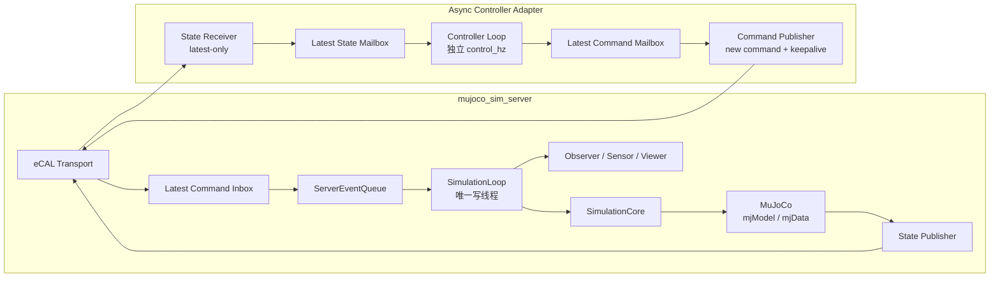
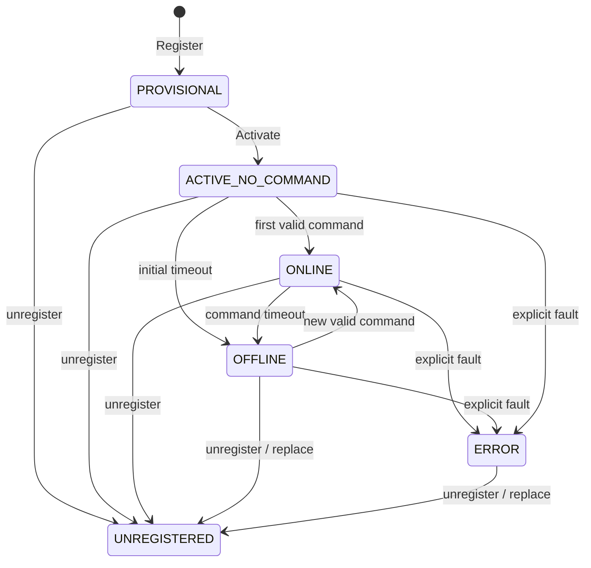
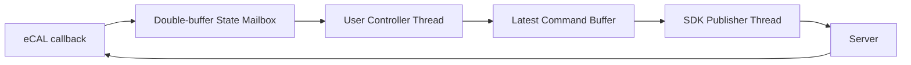
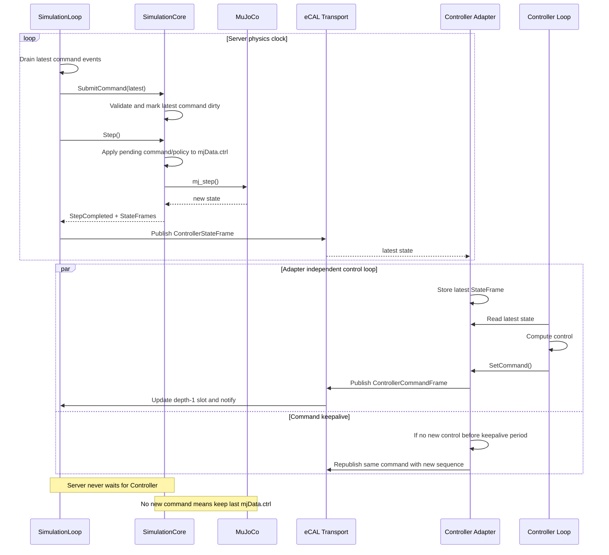

# mujoco_sim_core V1.4 异步流水线 Controller 完整改造方案

> 本文描述 Protocol V4 的最终合入状态；V3、Barrier 和同步 SDK 仅作为历史迁移与删除背景出现。
> 本方案的目标是彻底移除 Controller 对每个仿真 Tick 的同步应答要求，使 MuJoCo 物理循环不再等待任何 Controller。
> Controller 使用最新状态计算控制量；Server 使用最后一次有效控制量持续推进仿真，即 **latest state + keep-last command**。

---

## 1. 方案结论

当前同步模型：

```text
Server 发布 Tick
    ↓
等待所有 Controller Commit
    ↓
Barrier 完成
    ↓
写入 ctrl
    ↓
mj_step()
```

改造后的异步流水线模型：

```text
Server 按自身时钟持续 mj_step()
    ↓
发布最新 ControllerStateFrame
    ↓
Controller 独立频率读取最新状态并计算
    ↓
发布 ControllerCommandFrame
    ↓
Server 接收后替换该 Controller 的 last command
    ↓
后续 mj_step() 自动使用最新命令
```

核心变化：

1. Controller 不再需要对每个 Tick 做出回应；
2. Server 不再创建或等待 Controller Barrier；
3. Server 在没有新命令时持续使用最后一次有效命令；
4. Controller 命令与 Server 状态帧都是 latest-wins；
5. Controller 超时只改变 Online/Offline 状态，不阻塞仿真；
6. Controller 恢复后发送一条新的有效命令即可重新 Online；
7. 资源注册、资源独占、Session、Epoch、Layout 校验继续保留；
8. `SimulationLoop` 单写者模型继续保留；
9. Observer、Sensor、Viewer 不需要跟随 Controller 架构重写。

---

# 2. 改造目标

## 2.1 功能目标

新的 Controller 通信模型应满足：

- Server 无 Controller 时也可以持续运行；
- Controller 未及时发布命令时，Server 不等待；
- Controller 计算频率可与 MuJoCo timestep 不同；
- Controller 可以跳过任意数量的状态帧；
- Controller 可以低于或高于仿真频率发布命令；
- 同一物理步之前收到多条命令时，只使用最新一条；
- Controller 短暂离线不会停止仿真；
- Controller 重启或恢复后不需要 recovery proof；
- 多个 Controller 仍可控制互不冲突的 actuator；
- 失效 Controller 的命令处理方式可配置；
- Server 周期记录 Step rate、实际 realtime factor 和 Adapter 基本状态统计。

## 2.2 性能目标

改造后，Controller 不应再进入物理步进的等待路径。

在正常运行中：

```text
step 周期
=
事件处理
+ 必要的 ctrl 更新
+ mj_step
+ 状态发布
+ 传感器后处理
+ pacing
```

不再包含：

```text
等待 Controller 计算
等待 Commit
Barrier timeout
Tick retransmission
Recovery proof
```

目标指标：

| 指标 | 目标 |
|---|---:|
| Controller 对物理步进的阻塞时间 | 0 |
| 无 Controller 时是否继续仿真 | 是 |
| 单个 Controller 超时是否阻塞其他 Controller | 否 |
| 状态帧积压 | 不允许，latest-only |
| 命令帧积压 | 不允许，latest-only |
| 同一 session 命令队列深度 | 1 |
| 正常 Tick 重传 | 0 |
| Recovery Proof 消息 | 0 |
| Barrier 等待 | 0 |
| Controller 恢复所需有效消息 | 1 条新命令 |

---

# 3. 与 `wbr_mujoco` 的关系

`wbr_mujoco` 的关键性能特征不是简单地“异步 eCAL”，而是把控制计算与仿真步进解耦。

它的 Controller 侧大致分为：

```text
State 接收
    ↓
内部消息 latest value
    ↓
IMU / FSM / LQR 等控制线程独立运行
    ↓
缓存最新 motor command
    ↓
通信线程使用最新 motor command
```

本方案进一步去掉 `wbr_mujoco` 中仍然存在的“收到 Tick 后发送 Commit”语义，直接改为：

```text
状态流和命令流相互独立
```

即：

- StateFrame 只是 Server 发布的状态快照；
- CommandFrame 只是 Controller 发布的最新控制快照；
- V1.4 不在 Command 中携带 source-state tick/time；
- Server 不等待命令；
- Server 只在下一 Step 边界应用当时最新的有效命令。

---

# 4. 新架构概览



保留的边界：

```text
Transport
    ↓
ServerEventQueue / Latest Inbox
    ↓
SimulationLoop
    ↓
SimulationCore
    ↓
MuJoCo
```

任何 eCAL callback 仍然不能直接修改：

```text
SimulationCore
mjData
Controller lifecycle
```

---

# 5. 新的时间与数据语义

## 5.1 StateFrame 语义

`ControllerStateFrame` 表示：

> MuJoCo 完成某个物理步之后的最新状态快照。

定义：

```text
state[k]
=
完成第 k 次 mj_step 后的 simulation state
```

状态帧包含：

- session_id；
- epoch；
- layout fingerprint；
- state_sequence；
- tick_id；
- simulation_time_s；
- 扁平 observation values。

状态帧不要求 Controller 应答。

Controller 可以：

- 处理每一帧；
- 跳过部分帧；
- 只处理最新帧；
- 以低于 state publish rate 的频率运行；
- 暂停计算后继续从最新帧恢复。

## 5.2 CommandFrame 语义

`ControllerCommandFrame` 表示：

> Controller 当前希望 Server 使用的最新控制值。

命令帧包含：

- session_id；
- epoch；
- layout fingerprint；
- command_sequence；
- command values。

Command 的 64-byte header 不包含 tick、simulation time 或 source-state
信息。V1.4 不做 source lag 拒绝、来源追踪或相关 flags。

## 5.3 命令应用语义

Server 在每次 Step 前 drain depth-1 Inbox。同一边界前收到 A/B/C 时只
接受最新候选 C；通过 Core 校验后，C 在该边界写入 ctrl。没有新命令时
不重复写 ctrl，MuJoCo 继续使用末值。

---

# 6. Server 运行主循环

## 6.1 新主循环

推荐的 `SimulationLoop`：

```cpp
while (!stop_requested) {
  auto events = queue.WaitUntil(next_step_deadline);

  for (auto& event : events) {
    HandleEvent(event);
  }

  auto now = Clock::now();

  if (now >= next_step_deadline) {
    ApplyControllerLiveness(now);
    auto effects = core.Step();
    ApplyEffects(std::move(effects));

    next_step_deadline += step_period;

    if (next_step_deadline < now - maximum_lag) {
      next_step_deadline = now;
    }
  }

  ProcessLowRateTimers(now);
}
```

关键原则：

1. 事件先于到期 Step 处理；
2. 收到的最新命令在下一次 `mj_step()` 中生效；
3. 无论有没有 Controller 命令，Step 都继续；
4. 不存在 `tick_open`；
5. 不存在 `BarrierCoordinator::Ready()`；
6. 不存在 Tick 重传；
7. 不存在 Commit 导致 Step；
8. 只有调度时钟导致 Step。

## 6.2 当前同步逻辑的删除项

从 `SimulationLoop` 删除：

```text
OpenTicks()
PublishTicks()
InitializeTickRetries()
PublishDueTickRetries()
TickSubscribersReady()
tick_retries_
encoded_ticks_
active_controllers_ 对 Barrier 的用途
```

删除当前分支：

```cpp
if (!state.tick_open && now >= next_tick_) {
  OpenIssuedTicks();
} else if (state.tick_open) {
  PublishDueTickRetries();
}
```

替换为：

```cpp
if (now >= next_step_) {
  ApplyEffects(core_.Step());
}
```

## 6.3 不等待 Subscriber

当前 Server 可能通过：

```text
TickSubscribersReady()
```

等待 Controller subscriber 准备好。

异步模式下必须删除这一行为。

Server 应在以下场景都继续运行：

- 没有注册 Controller；
- Controller 注册但未 Activate；
- Controller 已 Activate 但没有 Subscriber；
- Controller Offline；
- Controller 正在重启；
- eCAL 暂时没有订阅端。

V1.4 不引入 `start_paused`、Pause、Resume 或 SingleStep；Controller 是否在线
不能成为物理循环条件。

---

# 7. SimulationCore 领域模型改造

## 7.1 删除 Barrier 模型

删除：

```text
BarrierCoordinator
TickStore
IssuedTick
IssuedTickHandle
IssuedTickIdentity
OpenIssuedTicks()
CompleteEmptyBarrier()
CompleteBarrier()
IsIssuedTickCurrent()
StepCompletionSource::kCommit
StepCompletionSource::kTimeout
RecoveryProof
required_for_barrier
tick_open
```

删除对应文件或职责：

```text
internal/barrier_coordinator.*
internal/tick_store.*
internal/lockstep_engine.cpp
```

`lockstep_engine.cpp` 应被新的：

```text
async_step_engine.cpp
```

或更简单的：

```text
simulation_step.cpp
```

替代。

## 7.2 新 Controller command state

每个 Controller record 直接保存：

```cpp
struct ControllerRecord {
  AdapterState state = PROVISIONAL;
  ResourceLayout layout;
  ControllerRuntimePolicy granted_policy;
  bool has_valid_command = false;
  bool command_dirty = false;
  std::vector<double> last_command;
  std::uint64_t last_command_sequence = 0;
  std::chrono::steady_clock::time_point last_command_received_at{};
  ObservationDelivery state_delivery;
};
```

Controller session 仍然保存：

- adapter_id；
- session_id；
- epoch；
- ResourceLayout；
- command ownership；
- lifecycle state；
- timeout 配置。

## 7.3 命令写入策略

`SubmitCommand()` 只校验并替换 latest command，同时设置 dirty；不在
transport callback 或事件处理过程中直接写 `mjData->ctrl`。

```text
callback -> depth-1 Inbox -> SimulationLoop -> Core::SubmitCommand()
```

处理流程：

```text
收到最新 CommandFrame
    ↓
校验 session / epoch / layout
    ↓
校验 command_sequence
    ↓
校验 scalar count / finite / range
    ↓
替换 ControllerCommandState.values
    ↓
标记 command dirty
    ↓
更新 last_command_received_at
```

下一次 `Step()` 在 `mj_step()` 前统一应用最终 dirty command 或待生效
policy write；同一边界后到的新 Command 覆盖先前 policy write。之后如果
没有新命令：

```text
mjData->ctrl 保持不变
```

MuJoCo 自身会在后续 `mj_step()` 中继续使用当前 `ctrl`。

这种方式比每个 Step 重建所有 Controller 的 WritePlan 更简单，也更快。

## 7.4 Step API

新增：

```cpp
EngineEffects SimulationCore::Step();
```

执行：

```cpp
EngineEffects SimulationCore::Step() {
  ApplyPendingControllerWrites();
  model_runtime_.Step();
  ++current_tick_id_;
  BuildControllerStateFrames();
  BuildObserverFrames();
  return effects;
}
```

`StepCompletedEvent` 建议改为：

```cpp
struct StepCompletedEvent {
  std::uint64_t completed_tick_id = 0;
  double simulation_time_s = 0.0;

  std::vector<ControllerStateFrame> controller_frames;
  std::vector<ObservationFrame> observer_frames;
};
```

不再包含：

```text
StepCompletionSource
```

因为 Step 只可能由 SimulationLoop 调度产生。

---

# 8. Keep-last 控制语义

## 8.1 正常状态

收到一条有效命令后：

```text
last_ctrl = command
```

之后每个 Step：

```text
如果没有新命令：
    使用 last_ctrl
```

多个 Controller 控制不同 actuator 时：

```text
Controller A last_ctrl → A 所有 actuator
Controller B last_ctrl → B 所有 actuator
```

资源独占继续保证它们不会写同一 actuator。

## 8.2 首条命令之前

Controller Activate 后尚未收到第一条命令时，应使用明确策略。

配置：

```yaml
startup_ctrl_policy: zero
```

可选值：

```text
zero
hold_last
```

推荐默认：

```text
zero
```

解释：

- `zero`：将该 Controller 声明的 actuator ctrl 设为 0；
- `hold_last`：保留当前 `mjData->ctrl`。

不要让未初始化的内存或旧 session 命令继续生效。

## 8.3 Offline 后的命令策略

配置：

```yaml
offline_ctrl_policy: hold_last
```

可选值：

```text
hold_last
zero
```

为符合本次设计，默认：

```text
hold_last
```

即 Controller Offline 后：

- Server 标记 Offline；
- ServerStatus 更新；
- 仿真继续；
- actuator 继续使用最后一次有效命令；
- 不自动清零；
- 不阻塞 Step。

对于容易失稳或需要安全停机的模型，可配置：

```yaml
offline_ctrl_policy: zero
```

## 8.4 Unregister / Replace

默认：

```yaml
release_ctrl_policy: zero
```

Controller 被：

- Unregister；
- OFFLINE/ERROR Session 被同名新 Session 替换；
- OFFLINE Session 自动过期；
- Model reload；

时，默认将其资源清零。

这样可避免已不存在的 Controller 永久控制 actuator。

进入 `ERROR` 本身不是 release 场景：Session 继续持有 actuator ownership，并在
下一 Step 边界执行 `error_ctrl_policy`。只有后续 Unregister、合法替换或资源释放
才执行 `release_ctrl_policy`。

---

# 9. Controller Online / Offline 状态机

## 9.1 新状态

Protocol V4 固定使用：

```proto
enum AdapterState {
  ADAPTER_STATE_UNSPECIFIED = 0;
  PROVISIONAL = 1;
  ACTIVE_NO_COMMAND = 2;
  ONLINE = 3;
  OFFLINE = 4;
  ERROR = 5;
  UNREGISTERED = 6;
}
```

Observer 复用该枚举，但不使用 `ACTIVE_NO_COMMAND`。

状态图：



ERROR 是终态，只能通过 Unregister 或相同 `adapter_id` 重新 Register 恢复。
同名 Register 只允许原记录处于 `OFFLINE` 或 `ERROR`，并原子替换旧 Session；
`PROVISIONAL`、`ACTIVE_NO_COMMAND` 或 `ONLINE` 已存在时返回 `ALREADY_EXISTS`。

## 9.2 Offline 判定

Controller Offline 只依据：

```text
now - last_valid_command_received_at
```

使用：

```text
std::chrono::steady_clock
```

而不是：

- simulation_time；
- Tick 数量；
- Wall Unix time；
- Heartbeat；
- 是否回复当前 StateFrame。

原因：

- simulation 可能 paused；
- simulation 可能 unthrottled；
- 系统时间可能跳变；
- 用户明确希望按“多久没有发 command”判断。

## 9.3 Timeout 配置

将当前：

```text
commit_timeout_ms
```

改名为：

```text
command_timeout_ms
```

推荐默认：

```yaml
command_timeout_ms: 500
```

约束：

```text
0 < command_keepalive_ms < command_timeout_ms
```

例如：

```yaml
command_timeout_ms: 500
command_keepalive_ms: 100
```

## 9.4 Offline 不删除 Session

Controller Offline 后：

- Session 保留；
- 资源 ownership 保留；
- StateFrame 继续发送；
- last command 按策略处理；
- 新有效 CommandFrame 可立即恢复 Online；
- 不需要重新 Register；
- 不需要重新 Activate；
- 不需要 recovery proof。

可以增加可选的长期清理：

```yaml
offline_session_expire_ms: 0
```

其中：

```text
0 = 永不自动清理
```

推荐默认关闭自动清理。

Controller 进程重启时，使用相同 `adapter_id` Register，只能替换处于 `OFFLINE`
或 `ERROR` 的旧 Session；其他现存状态返回 `ALREADY_EXISTS`。

---

# 10. CommandFrame 接收规则

## 10.1 标识字段

新的命令帧需要：

```text
session_id
epoch
layout fingerprint
command_sequence
command scalar values
```

不再要求：

```text
command tick_id == current server tick
```

## 10.2 command_sequence

每个 Controller session 内：

```text
command_sequence
```

必须严格递增。

Server 规则：

| 情况 | 行为 |
|---|---|
| sequence > last accepted | 校验并接受 |
| sequence == last 且 payload 相同 | duplicate，拒绝并忽略 |
| sequence == last 且 payload 不同 | conflicting duplicate，拒绝 |
| sequence < last | stale，丢弃 |
| 新 session | 从 1 重新开始 |

注意：

> 相同 sequence 的网络重复包也属于拒绝，不应刷新 Online timeout。

如果 Controller 需要 keepalive，应发送：

```text
相同 command values
+
新的 command_sequence
```

## 10.3 多条命令在一个 Step 前到达

Server 采用 latest-wins：

```text
command seq 100
command seq 101
command seq 102
mj_step
```

实际应用：

```text
seq 102
```

seq 100 和 101 可以计入：

```text
Inbox transport 诊断
```

但不需要进入领域层历史队列。

## 10.4 不携带 source-state

V1.4 Command 不携带 source-state tick/time，不提供控制来源追踪或
max-source-lag 拒绝；header 和 flags 不为这些能力预留字段。

---

# 11. 无效命令处理

异步控制中，一条错误消息不应直接停止整个仿真。

## 11.1 分类

### 传输错误

例如：

- frame 截断；
- magic/version 错误；
- payload size 错误。

处理：

```text
丢弃
限频日志
不改变 last command
不刷新 timeout
```

### 身份错误

例如：

- session 不匹配；
- epoch 不匹配；
- layout fingerprint 不匹配。

处理：

```text
丢弃
不改变状态
不刷新 timeout
```

### stale / duplicate

处理：

```text
stale：丢弃
identical duplicate：拒绝并忽略
conflicting duplicate：拒绝并忽略
```

三者均不改变 last command、不刷新 liveness，也不令 Session 进入 `ERROR`。

### 数值错误

例如：

- NaN；
- Inf；
- scalar count 错误；
- command 超出 ctrl range。

处理：

```text
拒绝本帧
保留 last valid command
不刷新 liveness
```

## 11.2 错误阈值

V1.4 不实现无效命令计数阈值。stale、相同 duplicate、冲突 duplicate、
非 finite、越界或 layout 错误都只拒绝，不刷新 liveness，也不令 session
进入 `ERROR`。

## 11.3 ControllerFault

保留独立低频控制面消息：

```text
ControllerFault
```

但删除它对当前 Tick 的强绑定。

建议字段：

```proto
message ControllerFault {
  uint64 session_id = 1;
  uint64 epoch = 2;
  FaultCode code = 3;
  string message = 4;
}
```

收到 Fault：

- Controller 进入 ERROR；
- 仿真继续；
- actuator 执行 error policy；
- 不等待任何恢复消息；
- 只能 Unregister 或使用相同 `adapter_id` 重新 Register 恢复；V1.4 不提供
  Reset RPC。

---

# 12. 高频协议修改

Protocol V4 使用固定 Header + 扁平 double 数组的数据帧，并固定以下 Kind 和语义。

## 12.1 DataFrameKind

Protocol V4 固定为：

```cpp
enum class DataFrameKind {
  kControllerState = 1,
  kControllerCommand = 2,
  kObservation = 3,
};
```

Wire numeric value 固定为：

```text
1 / 2 / 3
```

但 Protocol major 必须更新，避免旧 Sync Adapter 误把新消息当成 Tick/Commit。

## 12.2 Header 字段映射

现有 Header：

```cpp
struct DataFrameHeader {
  DataFrameKind kind;
  std::uint8_t flags;
  std::uint64_t session_id;
  std::uint64_t epoch;
  std::uint64_t tick_id;
  LayoutFingerprint layout;
  std::uint64_t sequence;
  double simulation_time_s;
};
```

可以继续使用。

### ControllerStateFrame

```text
kind              = kControllerState
session_id        = Controller session
epoch             = model epoch
tick_id           = 状态对应的 completed physics tick
layout            = observation layout
sequence          = state sequence
simulation_time_s = 状态对应的 MuJoCo time
scalars           = observation values
```

### ControllerCommandFrame

```text
kind              = kControllerCommand
session_id        = Controller session
epoch             = model epoch
layout            = command layout
sequence          = command_sequence
scalars           = command values
```

Command 使用独立 64-byte header，不包含 `tick_id` 或
`simulation_time_s`；State/Observation 使用 80-byte header。

## 12.3 flags

删除：

```text
kDataFrameRecoveryProof
```

V1.4 三类高频 frame 的 flags 必须为零。keepalive 直接使用：

```text
新的 sequence
+
相同 command values
```

不使用专门 flag。

## 12.4 Protocol major

这是破坏性语义修改，Protocol 和 topic namespace 固定硬切到：

```text
mujoco_sim.v3 → mujoco_sim.v4
```

V4 实现必须拒绝 V3 framing，不保留兼容解析路径。

原因：

- Tick 不再需要应答；
- Commit 不再完成 Barrier；
- Tick ID 不再要求匹配当前 Step；
- TIMED_OUT 语义改变；
- Recovery Proof 删除；
- SDK API 完全改变。

不得在 V3 中静默更换这些语义。

---

# 13. 控制面协议修改

## 13.1 RegisterAdapterRequest

统一注册请求不携带 Controller timeout；Controller policy 完全由 Server
配置并在 Register response 中返回：

```proto
message RegisterAdapterRequest {
  string adapter_id = 1;
  AdapterRole role = 2;
  repeated string observation_names = 3;
  repeated string command_names = 4;

  // Observer 使用；Controller 忽略。
  uint32 session_timeout_ms = 5;
  ObservationDelivery delivery = 6;
}
```

## 13.2 RegisterAdapterResponse

返回：

```text
session_id
epoch
ResourceLayout
granted state delivery
granted command timeout
```

新增：

```proto
message ControllerRuntimePolicy {
  uint32 command_timeout_ms = 1;
  uint32 command_keepalive_ms = 2;
  ObservationDelivery state_delivery = 3;
  ControlPolicy startup_policy = 4;
  ControlPolicy offline_policy = 5;
  ControlPolicy error_policy = 6;
  ControlPolicy release_policy = 7;
  uint32 offline_session_expire_ms = 8;
}
```

由 Server 决定最终策略，Adapter 只读取 granted policy。

## 13.3 SessionHeartbeat

Controller 不再发送独立 Heartbeat。

`SessionHeartbeat` 只用于：

```text
Observer
Sensor Stream Client
其他没有 CommandFrame 的 session
```

Controller Online 检测只依据有效的新 CommandFrame。

---

# 14. StateFrame 发布策略

## 14.1 默认频率

Controller 状态默认：

```yaml
controller_state_every_n_steps: 1
controller_state_period_s: 0.0
```

即每个物理步发布一次。

Server 可通过全局默认或按 `adapter_id` override 配置：

```yaml
every_n_steps: 2
```

或：

```yaml
period_s: 0.002
```

Controller 注册请求不携带 cadence。Server 计算并返回最终 granted cadence，且
发布频率不得超过 `controller_state_max_rate_hz`（默认 1000 Hz）。

## 14.2 latest-only

StateFrame 不重传，不排队积压。

eCAL 侧应配置：

```text
history depth = 1
latest sample wins
```

Adapter SDK 内部也使用：

```text
双缓冲 latest mailbox
```

若 Adapter 控制循环比状态流慢：

```text
state 100
state 101
state 102
controller read
```

Controller 只读取：

```text
state 102
```

V1.4 不要求发布 per-controller skipped-state 诊断计数。

## 14.3 初始 StateFrame

Activate 不额外发布初始 State。首帧来自下一次 cadence 到期的 completed
Step，并使用 completed tick 和 simulation time。

## 14.4 Offline 时是否继续发布

Controller Offline 后仍继续发布 StateFrame。

原因：

- Controller 可能只是短暂停顿；
- 恢复需要最新状态；
- Offline 不代表 Session 被删除；
- 重新 Online 不需要重新 Register。

V1.4 不实现 Offline State 降频，保持同一 granted cadence。

---

# 15. CommandFrame 发布策略

## 15.1 Adapter 独立 control rate

Controller 计算频率与仿真频率解耦：

```yaml
controller:
  control_rate_hz: 500
```

即使 MuJoCo 为：

```text
1000 Hz
```

也可以：

```text
每 2 个物理步计算一次新命令
```

Server 在中间 Step 使用 keep-last。

## 15.2 命令发送

Controller 每次产生新控制量时：

```text
更新 latest command
```

Adapter SDK 发布线程：

- 发现新 command generation 时立即发布；
- 如果长时间没有新 command，则按 keepalive 周期重发相同值；
- keepalive 使用新的 command_sequence；
- 不需要等待 StateFrame；
- 不需要等待 Tick；
- 不需要 Server ack。

## 15.3 Keepalive command

因为 Online 判定只依据命令，Controller 即使控制值长期不变，也必须周期性发布命令。

推荐：

```yaml
command_keepalive_ms: 100
```

约束：

```text
keepalive_period <= command_timeout / 3
```

发送：

```text
相同 command values
新的 command_sequence
```

## 15.4 高频 Command generation 合并

如果 Controller 以高于 physics rate 的频率计算：

```text
control_rate = 2000 Hz
physics = 1000 Hz
```

Server 不需要处理全部历史命令。

SDK 的 depth-1 latest mailbox 会合并尚未发布的 generation，但 V1.4 不提供
最大 Command 发布频率配置或主动限流。

---

# 16. Server Controller Inbox

直接把每条 CommandFrame 都加入通用 `ServerEventQueue`，可能在高频 Controller 下形成积压。

因此增加：

```text
ControllerCommandInbox
```

## 16.1 结构

```cpp
class ControllerCommandInbox {
 public:
  bool Register(SessionId session);
  bool Publish(DecodedCommand command);
  bool PublishFault(ControllerFault fault);
  std::vector<DecodedCommand> Drain();
  std::vector<ControllerFault> DrainFaults();
  void Remove(SessionId session);
  void Close();

 private:
  struct Slot {
    std::optional<DecodedCommand> latest_command;
    std::optional<ControllerFault> latest_fault;
  };
};
```

## 16.2 callback 行为

eCAL callback：

```text
解析 frame
    ↓
基础 framing 校验
    ↓
覆盖该 session 的 latest command slot
    ↓
若 slot 首次变为 pending：
    直接唤醒 ServerEventQueue condition variable
    ↓
立即返回
```

Fault callback 使用同样的 per-session depth-1 slot。未知 session 不创建
slot；Command 或 Fault burst 都不会向通用 `ServerEventQueue` 写入 payload，
也不会占用其 FIFO 容量。

## 16.3 SimulationLoop 行为

```cpp
void DrainControllerInputs(TimePoint now) {
  for (auto& command : inbox.Drain()) {
    ApplyEffects(core_.SubmitCommand(command, now).effects);
  }
  for (auto& fault : inbox.DrainFaults()) {
    ApplyEffects(core_.SubmitFault(fault).effects);
  }
}
```

Command 先于 Fault drain，保证同一 Step 边界同时存在两者时，有效 Fault
最终使 session 进入终态 `ERROR`。注册时预留 slot，Unregister、替换、自动
过期时删除 slot；关闭 Inbox 会唤醒等待中的 SimulationLoop。

## 16.4 为什么不让 callback 直接写 Core

即使命令只是 latest-wins，也不能让 callback 直接写：

```text
mjData->ctrl
Controller state
last_command_received_at
```

否则会重新引入：

- callback 与 `mj_step()` 并发；
- command range 校验与 Model reload 竞争；
- Session replace 竞争；
- shutdown 生命周期问题。

单写者边界必须保留。

---

# 17. Adapter SDK 新设计

## 17.1 删除旧 Sync API

删除或最终废弃：

```text
SyncAdapterClient
TickLease
TickWaitResult
WaitForTick()
Commit(TickLease, commands)
cached_commit_
outstanding_tick_
recovery_proof
duplicate Tick retry Commit
```

## 17.2 新 Client

建议命名：

```cpp
AsyncControllerClient
```

或更中性的：

```cpp
ControllerClient
```

因为系统只保留异步 Controller 后，推荐最终使用：

```cpp
ControllerClient
```

## 17.3 新 API

```cpp
struct ControllerOptions {
  std::string server_name;
  std::string adapter_id;

  std::vector<std::string> observation_names;
  std::vector<std::string> command_names;

  std::uint32_t service_timeout_ms = 5000;
};

class StateLease {
 public:
  StateLease(const StateLease&) = delete;
  StateLease& operator=(const StateLease&) = delete;
  StateLease(StateLease&&) noexcept;
  StateLease& operator=(StateLease&&) noexcept;
  std::uint64_t tick_id() const noexcept;
  std::uint64_t sequence() const noexcept;
  double simulation_time_s() const noexcept;
  std::span<const double> observations() const noexcept;
};

enum class StateReadResult {
  kReceived,
  kTimeout,
  kStopped,
  kError,
};

class ControllerClient {
 public:
  bool Start(std::string* error);
  bool Activate(std::string* error);

  StateReadResult ReadLatestState(
      StateLease* state,
      std::string* error);

  StateReadResult WaitForNewState(
      std::chrono::milliseconds timeout,
      StateLease* state,
      std::string* error);

  bool SetCommand(
      std::span<const double> command_values,
      std::string* error);

  bool ReportFault(
      FaultCode code,
      std::string_view message,
      std::string* error);

  const ControllerLayout& layout() const;
  AdapterRegistration registration() const;

  void Stop();
  bool Unregister(std::string* error);
};
```

## 17.4 `SetCommand` 语义

`SetCommand()` 不必同步执行 eCAL Send。

它应：

```text
校验 scalar count
校验 finite
更新 latest command mailbox
command generation++
notify publisher thread
立即返回
```

实际 publisher thread：

```text
有新 generation：
    发送最新 command

keepalive 到期：
    使用相同 values 和新 sequence 发送

Stop：
    退出
```

这样：

- 控制线程不被 IPC Send 抖动阻塞；
- 多次快速 SetCommand 自动合并；
- keepalive 自动完成；
- 发送逻辑只有一个线程。

## 17.5 Adapter 内部线程模型



线程约束：

- eCAL callback 是 state mailbox 唯一 writer；
- Controller thread 是 state mailbox reader；
- Controller thread 可多次调用 `SetCommand()`；
- Publisher thread 是 eCAL command publisher 唯一调用者；
- Stop 必须唤醒 State wait 和 command publisher；
- public API 不暴露 Protobuf 或 eCAL 类型。

---

# 18. 参考 Controller 程序结构

```cpp
ControllerClient client(options);

std::string error;
if (!client.Start(&error) || !client.Activate(&error)) {
  return 1;
}

const auto q_span = client.layout().Observation("joint_pos");
const auto dq_span = client.layout().Observation("joint_vel");

std::vector<double> command(
    client.layout().command_scalar_count(), 0.0);

auto next_control = std::chrono::steady_clock::now();

while (running) {
  StateLease state;
  const auto result =
      client.WaitForNewState(std::chrono::milliseconds(5), &state, &error);

  if (result == StateReadResult::kReceived) {
    controller.Update(state.observations(), command);

    if (!client.SetCommand(command, &error)) {
      break;
    }
  }

  next_control += std::chrono::milliseconds(2);  // 500 Hz
  std::this_thread::sleep_until(next_control);
}
```

更严格的固定控制频率：

```cpp
StateLease latest_state;

while (running) {
  StateLease new_state;
  if (client.ReadLatestState(&new_state, &error) ==
      StateReadResult::kReceived) {
    latest_state = std::move(new_state);
  }

  if (latest_state) {
    controller.Update(latest_state.observations(), command);
    client.SetCommand(command, &error);
  }

  sleep_until(next_control);
}
```

---

# 19. ServerStatus 修改

当前与 Barrier 相关的字段应删除：

```text
required_for_barrier
last_commit_tick_id 的同步含义
```

`AdapterStatus` 保留生命周期和必要序列：

```proto
message AdapterStatus {
  string adapter_id = 1;
  AdapterRole role = 2;
  uint64 session_id = 3;
  AdapterState state = 4;
  string message = 5;

  uint64 state_since_tick_id = 6;
  uint64 timeout_count = 7;
  uint64 last_command_sequence = 8;
  uint64 last_observation_sequence = 9;
  optional uint64 last_delivery_tick_id = 10;
}
```

Status 仍按低频发布，不因每条命令立即发布完整 Status。

Lifecycle 变化：

```text
ONLINE → OFFLINE
OFFLINE → ONLINE
ACTIVE_NO_COMMAND → ONLINE
ACTIVE_NO_COMMAND / ONLINE / OFFLINE → ERROR（有效 ControllerFault）
```

可触发低延迟 lifecycle Status。

---

# 20. 配置方案

Server 严格 schema 使用扁平字段和 override sequence：

```yaml
model_path: ...
realtime_factor: 1.0
pacing_mode: realtime
command_timeout_ms: 500
command_keepalive_ms: 100
startup_ctrl_policy: zero
offline_ctrl_policy: hold_last
error_ctrl_policy: zero
release_ctrl_policy: zero
controller_state_every_n_steps: 1
controller_state_period_s: 0.0
controller_state_max_rate_hz: 1000.0
offline_session_expire_ms: 0
controller_overrides: []
status_period_ms: 100
log_summary_period_ms: 1000
```

严格 schema 必须接受 `log_summary_period_ms`，并在值为 `0` 时不调度、不输出任何
`event=server_summary`。

可选的 per-adapter override：

```yaml
controller_overrides:
  - adapter_id: wheel_leg_controller
    command_timeout_ms: 200
    command_keepalive_ms: 50
    offline_session_expire_ms: 0
    state_every_n_steps: 1
    state_period_s: 0.0
    startup_ctrl_policy: zero
    offline_ctrl_policy: zero
    error_ctrl_policy: zero
    release_ctrl_policy: zero
  - adapter_id: slow_arm_controller
    command_timeout_ms: 1000
    command_keepalive_ms: 200
    offline_session_expire_ms: 0
    state_every_n_steps: 5
    state_period_s: 0.0
    startup_ctrl_policy: zero
    offline_ctrl_policy: hold_last
    error_ctrl_policy: zero
    release_ctrl_policy: zero
```

Server 注册时按：

```text
adapter_id
```

查找 override，并在 Register response 中返回最终 granted policy。

---

# 21. 当前代码对应修改位置

## 21.1 Protocol

```text
core/mujoco_sim_protocol/
```

修改：

- Protocol 和 topic namespace 固定为 V4，并拒绝 V3 framing；
- `kTick` 改为 `kControllerState`；
- `kCommit` 改为 `kControllerCommand`；
- 删除 recovery proof flag；
- `commit_timeout_ms` 改为 `command_timeout_ms`；
- 固定 `AdapterState` 枚举；
- AdapterStatus 更新；
- ControllerFault 去 Tick 强绑定；
- 保留扁平 data frame codec。

## 21.2 Core public API

```text
core/mujoco_sim_core/include/mujoco_sim/core/simulation_core.hpp
```

删除：

```cpp
OpenIssuedTicks();
IsIssuedTickCurrent();
CompleteEmptyBarrier();
SubmitCommit();
```

新增：

```cpp
EngineResult<CommandReceipt> SubmitCommand(
    const ControllerCommand& command,
    std::chrono::steady_clock::time_point now);

EngineEffects Step();

EngineEffects CheckDeadlines(
    std::chrono::steady_clock::time_point now);
```

`CheckDeadlines(now)` 处理：

- activation timeout；
- Controller command offline；
- OFFLINE Session 自动过期；
- Observer session timeout。

## 21.3 Core internal

删除或重写：

```text
barrier_coordinator.*
tick_store.*
lockstep_engine.cpp
commit_engine.cpp
```

新增：

```text
controller_command_store.*
async_command_engine.cpp
simulation_step.cpp
```

也可以不新增过多类，直接将命令状态放入：

```text
AdapterRegistry::Controller
```

推荐避免建立新的 Manager 包装层。

## 21.4 Server

```text
core/mujoco_sim_server/src/simulation_loop.*
```

删除：

- Barrier 调度；
- Tick open；
- Tick cache；
- Tick retry；
- Subscriber ready gate；
- Commit 触发 Step。

新增：

- 固定时钟 Step；
- 注册期有界的 ControllerCommandInbox；
- StateFrame publish；
- Online/Offline metrics。

## 21.5 Transport

```text
core/mujoco_sim_server/src/ecal_server_transport.*
```

修改：

- tick publisher 改 state publisher；
- commit subscriber 改 command subscriber；
- callback 写入 latest Command/Fault inbox；
- 不再维护 retransmission；
- publisher queue 使用 latest semantics。

## 21.6 Adapter SDK

```text
core/mujoco_sim_adapter/mujoco_sim_adapter_sdk/
```

删除：

```text
sync_adapter_client.*
sync_adapter_client_wait_commit.cpp
TickLease
```

新增：

```text
controller_client.hpp
controller_client.cpp
controller_client_receive.cpp
controller_client_publish.cpp
internal/controller_client_impl.hpp
internal/latest_state_mailbox.hpp
internal/latest_command_mailbox.hpp
```

## 21.7 Demo

当前同步 demo：

```text
WaitForTick()
controller.HandleTick()
Commit()
```

修改为：

```text
ReadLatestState()
controller.Update()
SetCommand()
```

并将控制循环频率放到 demo 配置中。

---

# 22. 与 Observer、Sensor 的关系

## 22.1 Observer

Observer 已经是异步消费模式，不需要大改。

可以保留：

```text
ObservationFrame
ObservationDelivery
Observer Heartbeat
```

ControllerStateFrame 和 ObservationFrame 的区别：

| 类型 | 用途 |
|---|---|
| ControllerStateFrame | 为 Controller 提供其注册布局下的最新控制状态 |
| ObservationFrame | 为非控制 Observer 提供低频数据 |
| SensorFrame | Camera、Depth、LiDAR 等大数据 |

不要让 Controller 改用 Observer 接口，否则会失去：

- Controller Session；
- command ownership；
- Online/Offline；
- command policy。

## 22.2 Sensor

SensorRuntime 不参与 Controller 同步，本方案不修改其基本架构。

仍建议：

```text
latest queue
non-blocking
```

如启用 blocking sensor capture，它仍可能影响 RTF，但与 Controller 架构无关。

## 22.3 Viewer

Viewer 继续读取 Snapshot，不参与 Controller Online 状态。

---

# 23. 确定性与回放

异步流水线会改变系统的确定性定义。

同步 Barrier 模式下：

```text
同一个 Tick 等待同一组 Commit
```

异步模式下，某条命令应用在哪个 Step，取决于：

- Controller 计算耗时；
- IPC 延迟；
- OS 调度；
- SimulationLoop 何时取出事件。

因此单纯固定随机种子不能保证完全相同轨迹。

## 23.1 V1.4 范围

V1.4 不实现 recorder、source-state 或 applied-tick 追踪。确定性回放需要
未来单独设计，不扩展本版 Command header。

## 23.2 Step 边界定义

必须明确：

> SimulationLoop 在开始 `mj_step(k)` 前已经处理完的命令，才可能用于 Step k；在 `mj_step(k)` 期间到达的命令最早用于 Step k+1。

由于 Core 只有单写者，此规则在一次运行中是明确的。

---

# 24. 性能与实时因子收益

改造后删除的热路径工作：

- Barrier membership 构建；
- 每 Tick pending Commit map；
- required Controller set；
- 每 Tick TickStore；
- Tick retry schedule；
- Tick retransmission；
- recovery proof；
- Commit 到齐检查；
- Commit 直接触发 CompleteBarrier；
- Controller timeout 导致 Barrier 补完成；
- Controller compute time 对 Step 的直接等待。

理论上：

```text
RTF
不再受最慢 Controller 的单周期计算时间直接限制
```

Controller 即使偶发耗时：

```text
5 ms
```

而 MuJoCo timestep 为：

```text
1 ms
```

Server 仍然可以继续以 1 kHz 推进，只是在这几步使用旧命令。

这正是 keep-last 流水线的性能收益，也是它与严格 lockstep 的语义交换：

```text
牺牲零延迟严格同步
换取高 RTF 和控制/物理并行
```

## 24.1 周期 Server 基本统计

Server 以 info 级别周期输出结构化日志：

```text
event=server_summary
tick_id=<completed step count>
interval_steps=<本窗口完成的 Step 数>
simulation_time_s=<累计仿真时间>
interval_simulation_s=<本窗口仿真时间增量>
interval_wall_s=<本窗口 steady-clock 时间增量>
step_rate_hz=<interval_steps / interval_wall_s>
realtime_factor_rate=<interval_simulation_s / interval_wall_s>
target_realtime_factor=<配置 realtime_factor>
pacing_mode=<realtime|unthrottled>
```

`realtime_factor_rate` 是实际测量值，不得用 `target_realtime_factor` 或配置值代替。
`step_rate_hz` 与 `realtime_factor_rate` 都按相邻两次汇总之间的同一窗口计算；窗口 wall
time 必须使用 steady clock，避免系统时间调整污染统计。Controller/Observer 状态计数、
malformed message 等基本计数可附加在同一事件中，其中窗口型计数在输出后清零。

`realtime` 模式下实际倍率可与目标倍率比较；`unthrottled` 模式下它表示宿主机当前吞吐，
可以远高于配置目标。`log_summary_period_ms: 0` 必须严格禁用该周期事件，而不是以零周期
忙循环或退回默认周期。

---

# 25. Metrics

V1.4 的必需 Server 统计通过周期 `event=server_summary` 输出：

```text
interval_steps
step_rate_hz
interval_simulation_s
interval_wall_s
realtime_factor_rate
target_realtime_factor
pacing_mode
active/online/offline/error controller counts
online observer count
malformed_messages
```

丰富的 per-controller 调试计数、命令 age/source lag、延迟百分位和回放
recorder 延期到后续版本。

---

# 26. 测试方案

## 26.1 Core 单元测试

必须覆盖：

### 无 Controller

```text
连续 Step
tick_id 持续增加
simulation time 持续增加
```

### 首条命令前

```text
Activate Controller
没有 Command
按 startup policy 推进
```

### Keep-last

```text
发送 command A
连续 Step 100 次
无新 command
每一步均使用 A
```

### Latest-wins

```text
同一 Step 前发送 A、B、C
最终 Step 使用 C
```

### 命令到达边界

```text
Step 前处理 → 当前 Step 生效
Step 后处理 → 下一 Step 生效
```

### Out-of-order

```text
sequence 10 接受
sequence 9 拒绝
last command 不改变
```

### Duplicate

```text
sequence 10 相同 payload → 拒绝且不刷新 liveness
sequence 10 不同 payload → 拒绝
```

### Offline

```text
超过 command_timeout
Controller → OFFLINE
仿真继续
按 offline policy 使用命令
```

### 恢复

```text
OFFLINE 收到 sequence 11
立即 ONLINE
新命令用于后续 Step
无需 recovery proof
```

### Invalid command

```text
NaN / Inf / range / count
拒绝
last valid command 保留
不刷新 liveness，不进入 ERROR
```

### Unregister

```text
释放 ownership
执行 release policy
其他 Controller 不受影响
```

### 多 Controller

```text
不同 actuator
不同命令频率
一方 Offline
另一方继续正常控制
```

## 26.2 Server E2E

- Server 无 Adapter 时正常运行；
- Controller 只订阅状态、不发命令；
- Controller 100 Hz，Server 1000 Hz；
- Controller 2000 Hz，Server 1000 Hz；
- Controller 进程 kill 后 Server 不停止；
- Controller 重启并替换 Session；
- eCAL 命令 burst 不填满 EventQueue；
- 每个已注册 session 的 Command/Fault 各保持 depth-1 latest slot；
- 没有 State subscriber 时 Server 不等待；
- Model reload 后旧 command 被拒绝；
- shutdown 不死锁。

## 26.3 Adapter SDK

- State latest mailbox 跳帧；
- `WaitForNewState()` 唤醒；
- Stop 唤醒等待；
- `SetCommand()` latest-only；
- publisher keepalive；
- Publisher Send 抖动不阻塞控制线程；
- Session/epoch 变化丢弃旧状态；
- command sequence 单调；
- callback 生命周期安全。

## 26.4 性能测试

对比：

```text
旧 Strict Sync Controller
新 Async Pipeline Controller
```

固定：

- 同一 MuJoCo 模型；
- 同一 timestep；
- 同一 Release build；
- 同一 Viewer/Sensor 配置；
- 同一机器；
- 同一控制算法。

记录：

```text
RTF
step p50/p95/p99
CPU
Step throughput
```

source lag、command age 和丰富的 skip/coalesce 指标延期。

---

# 27. 迁移计划

## 阶段 1：Protocol V4 与领域类型

完成：

- 新 State/Command 语义；
- Protocol major 4；
- 固定 `AdapterState` 枚举；
- Register 字段；
- Status 字段；
- data frame kind 重命名。

暂不删除旧实现，但新代码不接入主路径。

## 阶段 2：Core 异步命令路径

增加：

```text
SubmitCommand()
Step()
ControllerCommandState
Online/Offline
command policies
```

建立完整 Core 测试。

## 阶段 3：Server 异步 Step 主循环

改造：

- 固定时钟 Step；
- 移除 Barrier；
- 发布 StateFrame；
- CommandInbox；
- 移除 Tick retry；
- 无 Subscriber 继续运行。

## 阶段 4：新 Controller SDK

实现：

```text
ControllerClient
LatestStateMailbox
LatestCommandMailbox
Publisher Thread
keepalive
```

提供裸 Controller demo。

## 阶段 5：迁移所有 Demo 和 Adapter

包括：

- WBR demo；
- 直接裸 Controller；
- 测试工具；
- 性能 probe。

ROS 2 Controller Adapter 不在当前仓库 V1.4 MVP 范围内。

## 阶段 6：删除同步 Controller

删除：

```text
SyncAdapterClient
TickLease
BarrierCoordinator
TickStore
Recovery Proof
旧 E2E
旧文档
```

最终仓库只保留一种 Controller 语义，避免长期双架构维护。

---

# 28. 推荐 PR 顺序

## PR 1：Protocol V4

- 数据帧 Kind；
- 控制面消息；
- 状态枚举；
- protocol test；
- wire documentation。

## PR 2：Core command store

- ControllerCommandState；
- SubmitCommand；
- command validation；
- keep-last；
- policy tests。

## PR 3：Core Step

- 独立 Step；
- 删除 CompleteBarrier 依赖；
- StateFrame 构建；
- Observer frame 保持。

## PR 4：Server command inbox

- latest command slots；
- coalesced event；
- burst tests。

## PR 5：Server async simulation loop

- fixed step schedule；
- no Barrier；
- no Tick retry；
- no subscriber gate；
- Online/Offline。

## PR 6：Controller SDK

- latest state；
- latest command；
- publisher thread；
- keepalive。

## PR 7：Demo

- WBR 异步控制；
- 裸 Controller。

## PR 8：旧同步架构删除

- dead code；
- tests；
- docs；
- quality baseline。

---

# 29. 不建议的实现

## 29.1 不要让 eCAL callback 直接写 `mjData->ctrl`

这会破坏单写者线程模型。

## 29.2 不要给每条命令建立无限队列

Keep-last 模型天然应该 latest-only。

## 29.3 不要继续保留 Barrier 作为“可选路径”

用户已经决定舍弃同步 Controller。长期保留两套主路径会：

- 增加状态机复杂度；
- 增加测试矩阵；
- 增加 Protocol 语义歧义；
- 让性能问题反复出现。

可以在迁移期间短暂共存，但最终应删除。

## 29.4 不要把 Offline 解释为停止物理仿真

Offline 只是 Controller 健康状态。

## 29.5 不要依赖 Controller Heartbeat 判定 Online

用户定义的是：

```text
多久没有发送有效 command
```

因此有效新 CommandFrame 才刷新 Controller Online timeout。

## 29.6 不要静默复用 V3 同步语义

这是 Protocol major breaking change，应显式升级版本。

---

# 30. 最终推荐语义

整个异步 Controller 系统最终应遵循以下规则：

```text
1. Server 永远按自身调度推进 MuJoCo。
2. Controller 永远不阻塞 Server Step。
3. StateFrame 不需要回复。
4. StateFrame 可以跳帧，只保留最新。
5. CommandFrame 不绑定当前 Tick。
6. CommandFrame 只替换 last command。
7. 没有新 Command 时继续使用 last command。
8. 多条 Command 到达时 latest wins。
9. 超时只标记 Offline，不停止仿真。
10. Offline 后按配置 hold-last 或 zero。
11. 新有效 Command 立即恢复 Online。
12. 不存在 recovery proof。
13. 不存在 Tick retransmission。
14. 不存在 Barrier。
15. actuator resource ownership 仍然独占。
16. 所有 Core 和 mjData 修改仍由 SimulationLoop 单线程完成。
```

---

# 31. 最终架构流程图



---

# 32. 完成验收清单

## Protocol

- [ ] Protocol major 已升级；
- [ ] Tick 已改为 ControllerStateFrame；
- [ ] Commit 已改为 ControllerCommandFrame；
- [ ] Command 不要求当前 Tick 匹配；
- [ ] Recovery Proof 已删除；
- [ ] `commit_timeout_ms` 已改为 `command_timeout_ms`；
- [ ] Status 不再包含 Barrier 字段。

## Core

- [ ] BarrierCoordinator 已删除；
- [ ] TickStore 已删除；
- [ ] `tick_open` 已删除；
- [ ] `SubmitCommand()` 已实现；
- [ ] `Step()` 与命令接收解耦；
- [ ] Keep-last 测试通过；
- [ ] Offline 不阻塞 Step；
- [ ] 多 Controller 独占正常。

## Server

- [ ] Step 仅由固定调度时钟触发；
- [ ] 无 Controller 也继续运行；
- [ ] 无 Subscriber 也继续运行；
- [ ] Tick retry 已删除；
- [ ] CommandInbox 是 latest-only；
- [ ] 通用 EventQueue 不会被命令 burst 填满；
- [ ] Online/Offline 只依赖新有效命令；
- [ ] Offline policy 生效。
- [ ] `event=server_summary` 按 `log_summary_period_ms` 周期输出；
- [ ] `step_rate_hz` 等于同窗口 `interval_steps / interval_wall_s`；
- [ ] `realtime_factor_rate` 等于同窗口仿真时间增量 / steady-clock wall time 增量；
- [ ] `log_summary_period_ms: 0` 时不输出 `server_summary`。

## Adapter SDK

- [ ] `SyncAdapterClient` 已删除；
- [ ] 不再存在 `WaitForTick()`；
- [ ] 不再存在 `Commit(TickLease)`；
- [ ] State mailbox latest-only；
- [ ] Command mailbox latest-only；
- [ ] 控制线程不被 eCAL Send 阻塞；
- [ ] keepalive command 正常工作；
- [ ] Stop 可中断所有等待线程。

## 性能

- [ ] Controller 计算时间不进入 Server Step 等待；
- [ ] 无 Barrier latency；
- [ ] 无 Tick retransmission；
- [ ] RTF 明显高于同步版本；
- [ ] Release/headless 日志中的 `step_rate_hz` 与 `realtime_factor_rate` 可用于 benchmark；
- [ ] Release/headless 同配置 benchmark 已完成。

---

## 33. 最终判断

这一架构改造不是简单地“把 Barrier timeout 调大”，而是彻底改变 Controller 与物理仿真的时间关系：

```text
严格同步：
state[k] → 必须得到 command[k] → step

异步流水线：
state[k] → 异步产生 command
Server 按时钟持续 step，并始终使用 latest command
```

对于目标是提高 `real_time_factor`、模拟真实控制器周期、允许外部或裸 Controller 独立运行的场景，异步流水线更合适。

代价是：

- 控制命令通常存在至少一拍延迟；
- 结果受线程和 IPC 到达时序影响；
- 完全确定性回放延期到后续版本。

在接受这一语义后，应彻底删除同步 Barrier Controller，而不是长期保留两套控制主链路。
