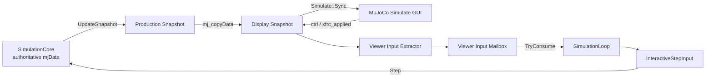

# 第一阶段方案：GUI Control + 鼠标拖拽施力

## 1. 阶段目标

第一阶段只实现两类 GUI → Server 输入：

1. **Control 面板**

   * 修改 actuator control；
   * 支持 `Clear all`；
   * 采用 **Last Writer Wins**；
   * GUI 不获得持续控制权，只产生一次性写入。

2. **鼠标拖拽施力**

   * 复用 MuJoCo Viewer 自带的物体选择、拖拽和扰动力计算；
   * 支持动态刚体的 force/torque；
   * 松开鼠标后自动清除；
   * Viewer 卡死或停止同步时，通过超时清除残留力。

第一阶段明确不实现：

```text
Equality
Joint qpos 编辑
mocap 拖动
Physics 参数编辑
Pause / Run
Reset / Keyframe
```

不修改 MuJoCo 的 `simulate.cc`，只读取 `Simulate::Sync()` 已经写入显示快照的数据。

MuJoCo passive viewer 的 `sync()` 本身就会把 GUI 控制输入和鼠标扰动写回 `mjData`；`mjv_applyPerturbForce()` 会把计算得到的空间力和力矩写入 `mjData::xfrc_applied`。([MuJoCo Documentation][1])

---

# 2. 最终数据流



核心原则保持不变：

> `SimulationCore` 所持有的 `mjData` 仍然只能由 Simulation Thread 修改。

Viewer worker 不直接访问 authoritative `mjData`。

---

# 3. Control 的精确定义

## 3.1 Last Writer Wins 语义

GUI Control 写入是一个**一次性事件**，而不是持续 override。

例如：

```text
Tick 100：Adapter 写 ctrl = 1.0
Tick 120：GUI Slider 写 ctrl = 0.2
Tick 121：没有新输入，ctrl 保持 0.2
Tick 130：Adapter 写 ctrl = 0.8
Tick 131：ctrl 保持 0.8
```

GUI 修改后，值能够保持，是因为 `mjData::ctrl` 自身会保留最后写入值，而不是因为 Server 每一步都重新应用 GUI control。

## 3.2 同一个 Step 的冲突规则

当前循环顺序是：

```cpp
DrainControllerInputs(now);
core_.Step();
```

修改后采用：

```cpp
DrainControllerInputs(now);
DrainViewerInputs(now);

core_.Step(interactive_input);
```

Core 内部顺序：

```cpp
ApplyControllerWrites();           // Adapter
ApplyInteractiveActuatorWrites();  // GUI
ApplyBodyWrenches();               // GUI mouse
mj_step();
```

因此定义为：

> Adapter 与 GUI 输入在同一个 Step 边界同时到达时，GUI 作为该 Step 的最后写入者。

但 GUI 写入不会持续覆盖。下一 Step 出现新的 Adapter command 时，Adapter 会重新成为最后写入者。

---

# 4. 鼠标施力的语义

MuJoCo Viewer 内部已经完成：

```text
鼠标选择物体
    ↓
mjv_select
    ↓
拖动鼠标
    ↓
mjv_initPerturb / mjv_movePerturb
    ↓
mjv_applyPerturbForce
    ↓
display_data->xfrc_applied
```

因此 Server 不需要重新实现：

* 屏幕坐标到射线；
* geom/body 选择；
* 拖拽方向计算；
* 力矩计算；
* 相机坐标系转换。

`xfrc_applied` 保存作用于 body 质心的笛卡尔力和力矩，原生 Viewer 也使用这一字段实现鼠标扰动。([MuJoCo Documentation][2])

每个 body 对应：

```text
Fx Fy Fz Tx Ty Tz
```

第一阶段只接受动态刚体的结果。mocap body 的 pose 变化不转发给 Server。

---

# 5. Viewer 输入数据结构

建议新增一个共享头文件：

```text
core/mujoco_sim_core/include/mujoco_sim/core/interactive_input.hpp
```

内容类似：

```cpp
#pragma once

#include <array>
#include <span>

namespace mujoco_sim::core {

/**
 * @brief One actuator control write from an interactive source.
 *
 * 来自交互输入源的一次 actuator 控制写入。
 */
struct InteractiveActuatorWrite {
  int actuator_id = -1;
  double value = 0.0;
};

/**
 * @brief Cartesian force and torque applied to one MuJoCo body.
 *
 * 施加到一个 MuJoCo body 的笛卡尔力和力矩。
 */
struct InteractiveBodyWrench {
  int body_id = -1;

  // World-frame force applied at the body center of mass.
  // 世界坐标系下作用于刚体质心的力。
  std::array<double, 3> force{};

  // World-frame torque about the body center of mass.
  // 世界坐标系下相对于刚体质心的力矩。
  std::array<double, 3> torque{};
};

/**
 * @brief Interactive values applied at one simulation Step boundary.
 *
 * 在一个仿真 Step 边界应用的交互式输入。
 */
struct InteractiveStepInput {
  // One-shot Last Writer Wins actuator writes.
  // 一次性的 Last Writer Wins actuator 写入。
  std::span<const InteractiveActuatorWrite> actuator_writes;

  // Current complete GUI wrench state.
  // 当前完整的 GUI 扰动力状态。
  std::span<const InteractiveBodyWrench> body_wrenches;

  // When true, body_wrenches replaces the previous interactive wrench state.
  // 为 true 时，body_wrenches 替换之前的交互扰动力状态。
  bool replace_body_wrenches = false;
};

}  // namespace mujoco_sim::core
```

这里必须区分：

* `actuator_writes`：一次性事件；
* `body_wrenches`：持续状态。

---

# 6. SimViewer 输出结构

在 `sim_viewer.hpp` 中增加：

```cpp
struct ViewerWrenchFrame {
  std::uint64_t sequence = 0;
  std::chrono::steady_clock::time_point generated_at;
  std::vector<mujoco_sim::core::InteractiveBodyWrench> body_wrenches;
};

struct ViewerInputBatch {
  std::vector<mujoco_sim::core::InteractiveActuatorWrite> actuator_writes;

  // nullopt means there was no new wrench frame.
  // Empty body_wrenches means explicitly clear all GUI forces.
  std::optional<ViewerWrenchFrame> wrench_frame;
};
```

以及：

```cpp
bool TryConsumeInput(ViewerInputBatch* output) noexcept;
```

约束：

```text
Simulation Thread 调用
绝不阻塞
没有新输入时返回 false
```

`sim_viewer_stub.cpp` 也要提供相同接口，固定返回 `false`，保证 headless 构建不受影响。

---

# 7. 在 Simulate::Sync() 后提取输入

当前代码位置：

```text
core/mujoco_sim_server/src/sim_viewer.cpp
SimViewer::Impl::SynchronizeBuffer()
```

现有逻辑：

```cpp
mj_copyData(display_snapshot->data(),
            display_snapshot->model(),
            production_snapshots[index]->data());

simulate->Sync();
```

改成：

```cpp
ViewerInputBatch extracted_input;

{
  const mujoco::MutexLock viewer_lock(simulate->mtx);

  mj_copyData(display_snapshot->data(),
              display_snapshot->model(),
              production_snapshots[index]->data());

  CaptureControlBeforeSync();

  simulate->Sync();

  ExtractControlWrites(&extracted_input);
  ExtractBodyWrenches(&extracted_input);
}

// 不要持有 MuJoCo viewer mutex 发布输入。
PublishInput(std::move(extracted_input));
```

## 7.1 Control 提取

在 `mj_copyData()` 后、`Sync()` 前保存：

```cpp
ctrl_before_sync.resize(model->nu);
mju_copy(ctrl_before_sync.data(), data->ctrl, model->nu);
```

`Sync()` 后逐 actuator 比较：

```cpp
for (int actuator_id = 0; actuator_id < model->nu; ++actuator_id) {
  const mjtNum before = ctrl_before_sync[actuator_id];
  const mjtNum after = data->ctrl[actuator_id];

  if (before != after) {
    input.actuator_writes.push_back({
        .actuator_id = actuator_id,
        .value = static_cast<double>(after),
    });
  }
}
```

建议使用精确比较，不使用 epsilon。

原因是 MuJoCo `Simulate::Sync()` 自己也是通过前后值变化判断 GUI 是否编辑 control。GUI slider 和 `Clear all` 最终都会反映为 `data->ctrl` 的变化。

## 7.2 Force 提取

每次成功执行 `Sync()` 后都生成一个新的完整 wrench frame：

```cpp
ViewerWrenchFrame frame;
frame.sequence = ++wrench_sequence;
frame.generated_at = Clock::now();

for (int body_id = 1; body_id < model->nbody; ++body_id) {
  const mjtNum* wrench = data->xfrc_applied + 6 * body_id;

  if (wrench[0] != 0.0 || wrench[1] != 0.0 ||
      wrench[2] != 0.0 || wrench[3] != 0.0 ||
      wrench[4] != 0.0 || wrench[5] != 0.0) {
    frame.body_wrenches.push_back({
        .body_id = body_id,
        .force = {wrench[0], wrench[1], wrench[2]},
        .torque = {wrench[3], wrench[4], wrench[5]},
    });
  }
}

input.wrench_frame = std::move(frame);
```

即使没有施力，也必须发布：

```cpp
wrench_frame.body_wrenches.empty()
```

它表示：

> 鼠标已经松开，请清除之前的 GUI 扰动力。

不能把空 frame 当成“没有输入”。

---

# 8. Viewer 输入邮箱设计

不能简单使用一个“最新 ViewerInputBatch 覆盖旧 Batch”的 depth-one mailbox。

原因是：

```text
Frame 1：Control 修改 actuator 2 = 0.5
Frame 2：没有新的 Control 修改，但有新的空 wrench frame
```

如果 Frame 2 整体覆盖 Frame 1，Control 写入会丢失。

因此邮箱需要对两种输入使用不同合并规则。

## 8.1 内部状态

```cpp
std::mutex input_mutex;

// 每个 actuator 独立保留最后一次尚未消费的 GUI 写入。
std::vector<std::optional<double>> pending_control_values;

// Wrench 是完整状态，最新 frame 覆盖旧 frame。
std::optional<ViewerWrenchFrame> latest_wrench_frame;
```

在 `QueueLoad()` 中根据模型大小初始化：

```cpp
pending_control_values.resize(display_model->nu);
```

## 8.2 发布规则

```cpp
void PublishInput(ViewerInputBatch input) {
  std::lock_guard lock(input_mutex);

  for (const auto& write : input.actuator_writes) {
    pending_control_values[write.actuator_id] = write.value;
  }

  if (input.wrench_frame) {
    latest_wrench_frame = std::move(input.wrench_frame);
  }
}
```

规则为：

| 输入                     | 合并方式             |
| ---------------------- | ---------------- |
| 同一个 actuator 多次 GUI 修改 | 保留最后一个值          |
| 不同 actuator 的修改        | 分别保留，不互相覆盖       |
| Wrench frame           | 完整状态，latest wins |
| 空 wrench frame         | 有效状态，表示清除        |

## 8.3 消费规则

Simulation Thread 使用 `try_lock`：

```cpp
bool SimViewer::TryConsumeInput(ViewerInputBatch* output) noexcept {
  std::unique_lock lock(impl_->input_mutex, std::try_to_lock);

  if (!lock.owns_lock()) {
    return false;
  }

  for (int id = 0; id < pending_control_values.size(); ++id) {
    if (!pending_control_values[id]) {
      continue;
    }

    output->actuator_writes.push_back({
        .actuator_id = id,
        .value = *pending_control_values[id],
    });

    pending_control_values[id].reset();
  }

  output->wrench_frame = std::move(latest_wrench_frame);
  latest_wrench_frame.reset();

  return !output->actuator_writes.empty() ||
         output->wrench_frame.has_value();
}
```

Simulation Thread 永远不会等待 Viewer worker。

---

# 9. SimulationLoop 接入

在 `simulation_loop.hpp` 中增加：

```cpp
std::vector<mujoco_sim::core::InteractiveActuatorWrite>
    pending_viewer_control_writes_;

std::vector<mujoco_sim::core::InteractiveBodyWrench>
    active_viewer_body_wrenches_;

std::chrono::steady_clock::time_point
    last_viewer_wrench_update_{};

bool viewer_wrench_state_received_ = false;
bool viewer_wrench_timed_out_ = false;
```

增加：

```cpp
void DrainViewerInputs(std::chrono::steady_clock::time_point now);
void ExpireViewerWrenches(std::chrono::steady_clock::time_point now);
```

## 9.1 消费 Viewer 输入

```cpp
void SimulationLoop::DrainViewerInputs(Clock::time_point now) {
  if (viewer_ == nullptr) {
    return;
  }

  SimViewer::ViewerInputBatch input;
  if (!viewer_->TryConsumeInput(&input)) {
    return;
  }

  for (auto& write : input.actuator_writes) {
    // 同一 actuator 只保留最后一次尚未 Step 的值。
    auto found = std::find_if(
        pending_viewer_control_writes_.begin(),
        pending_viewer_control_writes_.end(),
        [&](const auto& current) {
          return current.actuator_id == write.actuator_id;
        });

    if (found == pending_viewer_control_writes_.end()) {
      pending_viewer_control_writes_.push_back(write);
    } else {
      found->value = write.value;
    }
  }

  if (input.wrench_frame) {
    active_viewer_body_wrenches_ =
        std::move(input.wrench_frame->body_wrenches);

    last_viewer_wrench_update_ =
        input.wrench_frame->generated_at;

    viewer_wrench_state_received_ = true;
    viewer_wrench_timed_out_ = false;
  }
}
```

## 9.2 Step 调用

主循环改为：

```cpp
now = Clock::now();

DrainControllerInputs(now);
DrainViewerInputs(now);

ApplyEffects(core_.CheckDeadlines(now));

if (unthrottled || now >= next_step_) {
  ExpireViewerWrenches(now);

  const mujoco_sim::core::InteractiveStepInput input{
      .actuator_writes = pending_viewer_control_writes_,
      .body_wrenches = active_viewer_body_wrenches_,
      .replace_body_wrenches = viewer_wrench_state_received_,
  };

  ApplyEffects(core_.Step(input));

  // Control 是一次性写入，Step 完成后立即清除。
  pending_viewer_control_writes_.clear();

  ...
}
```

注意：

```text
Control：Step 后清空
Wrench：Step 后继续保留
```

---

# 10. Force 超时保护

正常松开鼠标时，下一个 Viewer sync 会发送空 wrench frame。

但还需要处理：

* Viewer window 卡死；
* sync worker 异常；
* GUI 线程停止；
* snapshot 长时间没有同步。

配置增加：

```yaml
viewer_control_input_enabled:
  type: bool
  description: Accept actuator control writes from the MuJoCo GUI
  default: true

viewer_mouse_force_enabled:
  type: bool
  description: Accept mouse perturbation forces from the MuJoCo GUI
  default: true

viewer_mouse_force_timeout_ms:
  type: uint32
  description: Clear stale GUI mouse forces after this timeout
  default: 100
  min: 1
```

超时逻辑：

```cpp
void SimulationLoop::ExpireViewerWrenches(Clock::time_point now) {
  if (!viewer_wrench_state_received_ ||
      active_viewer_body_wrenches_.empty()) {
    return;
  }

  const auto timeout =
      std::chrono::milliseconds(config_.viewer_mouse_force_timeout_ms);

  if (now - last_viewer_wrench_update_ <= timeout) {
    return;
  }

  active_viewer_body_wrenches_.clear();
  viewer_wrench_timed_out_ = true;
}
```

默认：

```text
viewer_sync_period_ms = 16 ms
force timeout = 100 ms
```

允许大约六个 Viewer sync 周期，能够避免正常抖动误触发。

---

# 11. SimulationCore 修改

将：

```cpp
EngineEffects Step();
```

改为：

```cpp
EngineEffects Step(const InteractiveStepInput& input = {});
```

实现顺序：

```cpp
EngineEffects SimulationCore::Step(
    const InteractiveStepInput& input) {
  EngineEffects out;

  if (!IsModelLoaded() ||
      impl_->server_state != RUNNING) {
    return out;
  }

  // Adapter writes first.
  impl_->ApplyControllerWrites();

  // GUI writes second: same-boundary tie goes to GUI.
  impl_->model->ApplyInteractiveActuatorWrites(
      input.actuator_writes);

  if (input.replace_body_wrenches) {
    impl_->model->ReplaceInteractiveBodyWrenches(
        input.body_wrenches);
  }

  impl_->model->Step();

  ...
}
```

原有不传参数的调用仍然有效：

```cpp
core.Step();
```

因此 package consumer 和已有测试不需要立刻修改。

---

# 12. ModelRuntime 修改

增加：

```cpp
void ApplyInteractiveActuatorWrites(
    std::span<const InteractiveActuatorWrite> writes);

void ReplaceInteractiveBodyWrenches(
    std::span<const InteractiveBodyWrench> wrenches);
```

并保存上一帧 GUI 占用的 body：

```cpp
std::vector<int> interactive_wrench_body_ids_;
```

## 12.1 Control 应用

```cpp
void ModelRuntime::ApplyInteractiveActuatorWrites(
    std::span<const InteractiveActuatorWrite> writes) {
  if (!loaded()) {
    return;
  }

  for (const auto& write : writes) {
    if (write.actuator_id < 0 ||
        write.actuator_id >= model_->nu ||
        !std::isfinite(write.value)) {
      continue;
    }

    data_->ctrl[write.actuator_id] =
        static_cast<mjtNum>(write.value);
  }
}
```

不要在这里 clamp。

GUI Slider 本身会根据 `actuator_ctrlrange` 工作。若以后加入其他 interactive input producer，再统一设计错误返回和 range 策略。

## 12.2 Wrench 替换

```cpp
void ModelRuntime::ReplaceInteractiveBodyWrenches(
    std::span<const InteractiveBodyWrench> wrenches) {
  if (!loaded()) {
    return;
  }

  // 只清除上一帧由 interactive input 占用的 body。
  for (const int body_id : interactive_wrench_body_ids_) {
    mju_zero(data_->xfrc_applied + 6 * body_id, 6);
  }

  interactive_wrench_body_ids_.clear();

  for (const auto& write : wrenches) {
    if (write.body_id <= 0 ||
        write.body_id >= model_->nbody) {
      continue;
    }

    mjtNum* target =
        data_->xfrc_applied + 6 * write.body_id;

    target[0] = write.force[0];
    target[1] = write.force[1];
    target[2] = write.force[2];
    target[3] = write.torque[0];
    target[4] = write.torque[1];
    target[5] = write.torque[2];

    interactive_wrench_body_ids_.push_back(
        write.body_id);
  }
}
```

这样不是每一步清零全部 `6 * nbody`，通常只处理一个被鼠标选中的 body。

MuJoCo 文档特别提示，扰动力需要清除旧 body 上残留的 `xfrc_applied`，否则切换选中 body 后旧力可能继续存在。([MuJoCo Documentation][3])

在 `Commit()` 时也要：

```cpp
interactive_wrench_body_ids_.clear();
```

---

# 13. 不应采用的方案

## 不要反向复制完整 mjData

禁止：

```cpp
mj_copyData(core_data, core_model, display_data);
```

因为 Viewer 展示的是延迟快照，完整复制会回滚：

```text
qpos
qvel
time
act
solver state
sensor state
```

只提取白名单：

```text
ctrl
xfrc_applied
```

## 不要直接从 Viewer worker 调用 Core

禁止：

```cpp
simulation_core->ApplyForce(...);
```

这会破坏 Simulation Thread 单写者模型。

## 不要重新实现鼠标射线和扰动力

第一阶段不直接调用：

```cpp
mjv_select
mjv_movePerturb
mjv_applyPerturbForce
```

原因不是这些 API 不合适，而是当前 `mujoco::Simulate::Sync()` 已经替我们调用了它们。我们只需要转发最终结果。

---

# 14. 文件修改范围

| 文件                                                              | 修改内容                                 |
| --------------------------------------------------------------- | ------------------------------------ |
| `mujoco_sim_core/include/mujoco_sim/core/interactive_input.hpp` | 新增交互输入公共类型                           |
| `simulation_core.hpp`                                           | `Step(const InteractiveStepInput&)`  |
| `simulation_core.cpp`                                           | Adapter → GUI → force → `mj_step` 顺序 |
| `internal/model_runtime.hpp/.cpp`                               | 应用 control 和 body wrench             |
| `mujoco_sim_server/src/sim_viewer.hpp`                          | ViewerInputBatch、TryConsumeInput     |
| `mujoco_sim_server/src/sim_viewer.cpp`                          | Sync 后提取 control/xfrc、输入邮箱           |
| `mujoco_sim_server/src/sim_viewer_stub.cpp`                     | headless 空实现                         |
| `simulation_loop.hpp/.cpp`                                      | 消费输入、保存 active force、超时处理            |
| `server_config.yaml`                                            | 三个 Viewer input 配置                   |
| `server_config.hpp/.cpp`                                        | 配置解析和校验                              |
| `sim_viewer_test.cpp`                                           | 提取和邮箱测试                              |
| `async_simulation_core_test.cpp`                                | LWW 和 wrench 应用测试                    |

不需要修改：

```text
Adapter protocol
eCAL transport
Adapter SDK
Controller 注册逻辑
MuJoCo simulate.cc
```

---

# 15. 测试计划

## Control 单元测试

### GUI 写入生效

```text
初始 ctrl = 0
GUI 输入 ctrl = 0.5
执行 Step
期望 ctrl = 0.5
```

### 同一 Step GUI 胜出

```text
Adapter command = 1.0
GUI write = 0.5
同一 Step 应用
期望 ctrl = 0.5
```

### 后续 Adapter 覆盖 GUI

```text
Step 1:
  GUI write = 0.5
  结果 = 0.5

Step 2:
  Adapter command = 1.0
  无 GUI write
  结果 = 1.0
```

### Control 邮箱不丢事件

```text
Frame 1:
  actuator 0 = 0.2

Frame 2:
  没有 control write
  空 wrench frame

消费后：
  actuator 0 = 0.2 仍然存在
```

### 多 actuator 合并

```text
Frame 1: actuator 0 = 0.2
Frame 2: actuator 1 = 0.3
Frame 3: actuator 0 = 0.4

消费结果：
  actuator 0 = 0.4
  actuator 1 = 0.3
```

## Force 单元测试

### Wrench 生效

对一个 free body 施加非零力，执行若干 Step，确认其速度或位置发生预期变化。

### 松开后清除

```text
Frame 1: body 1 force = [10, 0, 0]
Frame 2: empty wrench frame
```

确认：

```cpp
data->xfrc_applied[6 * body_id + i] == 0
```

### 切换 body

```text
Frame 1: body 1 有力
Frame 2: body 2 有力
```

确认 body 1 的旧力被清除。

### 超时清除

超过 `viewer_mouse_force_timeout_ms` 没有新 wrench frame，确认 active force 被清空。

## 性能和并发测试

确认：

* Simulation Thread 不阻塞等待 Viewer；
* Viewer idle 时没有持续 control writes；
* TSAN 下输入邮箱无数据竞争；
* idle Viewer 对 real-time factor 没有明显影响；
* headless 模式行为完全不变。

---

# 16. 验收标准

第一阶段完成后，应满足：

1. 在右侧 Control 面板拖动 Slider，下一次 Viewer Sync 后写入 Server；
2. `Clear all` 能够将对应 `ctrl` 清零；
3. GUI control 不会持续覆盖 Adapter；
4. Adapter 下一条 command 能够覆盖 GUI control；
5. 鼠标拖拽动态刚体时，Server 中的真实仿真状态受到力和力矩；
6. 松开鼠标后，扰动力在一个 Viewer Sync 加一个仿真 Step 内清除；
7. Viewer 异常停止同步后，残留力在默认 100 ms 内清除；
8. Viewer worker 不直接修改 authoritative `mjData`；
9. 不修改 MuJoCo 上游源码；
10. 不改变现有 eCAL 通信协议和 Adapter SDK。

建议实现顺序是：先完成 `InteractiveStepInput + ModelRuntime`，再实现 Viewer 输入提取与邮箱，最后接入 `SimulationLoop` 和测试。

[1]: https://mujoco.readthedocs.io/en/3.3.5/python.html?utm_source=chatgpt.com "Python - MuJoCo Documentation"
[2]: https://mujoco.readthedocs.io/en/3.1.2/computation/?utm_source=chatgpt.com "Computation - MuJoCo Documentation"
[3]: https://mujoco.readthedocs.io/en/2.2.0/programming.html?utm_source=chatgpt.com "Programming — MuJoCo documentation"
