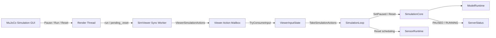
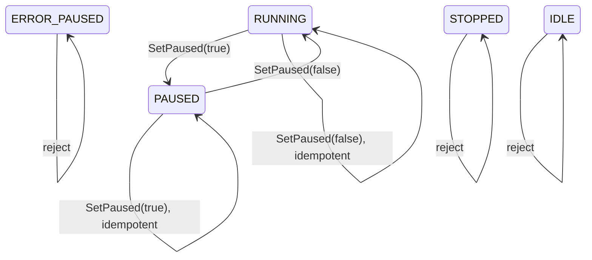

# MuJoCo GUI Pause / Run + Reset 接入方案

> 适用仓库：`mujoco_sim_core-dev`  
> 方案基线：上传代码包中的提交 `6f68200f4223c185aaba7e02fbb1db4c2b9043ec`  
> 目标版本：GUI 交互第二阶段  
> 前置能力：Control 面板 Last Writer Wins、鼠标拖拽施力已经接入

---

## 1. 方案目标

本阶段为现有 MuJoCo passive viewer 增加以下 GUI → Server 控制能力：

1. **Pause**
   - 暂停物理仿真推进；
   - 不停止 Server、通信、状态发布和 Viewer 刷新；
   - `tick_id` 和 `simulation_time_s` 在暂停期间保持不变。

2. **Run**
   - 从手动暂停状态恢复物理仿真；
   - 恢复时不补算暂停期间错过的墙钟时间；
   - 恢复后的下一步从当前墙钟时刻重新建立 pacing 基准。

3. **Reset**
   - 使用 MuJoCo 原生 reset API 恢复模型初始状态；
   - 支持配置的 `initial_keyframe`；
   - 保留模型、资源表、Adapter session、资源所有权和 `epoch`；
   - 保持 Reset 前的 Pause / Run 状态；
   - 清除 GUI Control、鼠标扰动力和 Controller 旧 command；
   - `tick_id` 保持单调，不回退。

本阶段不实现：

```text
Reload
Num threads
Load key / Save key
History
Noise scale / Noise rate
Pause 状态下单步 Step
空格键 Pause / Run 快捷键
远程 RPC Pause / Run / Reset
```

---

## 2. 当前代码基线

当前仓库已经具备完整的 GUI 输入反向通路：

```text
MuJoCo Render Thread
        │
        │ 修改 Simulate GUI 状态
        ▼
SimViewer Sync Worker
        │
        │ Simulate::Sync()
        ▼
SimViewer Input Mailbox
        │
        │ TryConsumeInput()
        ▼
ViewerInputState
        │
        │ PrepareStep()
        ▼
SimulationLoop
        │
        │ SimulationCore::Step(input)
        ▼
authoritative mjData
```

现有代码已经满足以下基础约束：

- `SimulationLoop` 是 `SimulationCore` 的唯一运行期调用线程；
- Viewer worker 不直接修改 authoritative `mjData`；
- Control 输入按 actuator 合并；
- 鼠标扰动力采用完整状态 latest-wins；
- GUI 输入获取不会阻塞仿真线程；
- Viewer 使用独立的 display snapshot 和双 production snapshot。

本阶段继续沿用这一架构，不新增 Viewer → Core 的跨线程直接调用。

---

## 3. 核心设计决策

### 3.1 新增正常手动暂停状态 `PAUSED`

当前状态枚举为：

```text
IDLE
RUNNING
ERROR_PAUSED
STOPPED
```

新增：

```text
PAUSED
```

`PAUSED` 表示用户主动暂停，是正常运行状态；`ERROR_PAUSED` 表示故障状态，两者不能混用。

协议枚举必须追加到末尾：

```proto
enum ServerState {
  SERVER_STATE_UNSPECIFIED = 0;
  IDLE = 1;
  RUNNING = 2;
  ERROR_PAUSED = 3;
  STOPPED = 4;
  PAUSED = 5;
}
```

这样不会改变现有枚举数值，保持 protobuf wire compatibility。

### 3.2 Pause 只暂停物理时间

进入 `PAUSED` 后停止调用：

```cpp
SimulationCore::Step(...)
```

暂停期间继续执行：

- Adapter 注册、激活、注销；
- Controller command 接收；
- Observer heartbeat；
- Controller/Observer deadline 检查；
- ServerStatus 周期发布；
- Viewer snapshot 周期更新；
- Viewer GUI 输入消费；
- Reset 和 Run action；
- transport 与 summary 指标采样。

因此 Pause 不是线程挂起，也不是 Server shutdown。

### 3.3 Run 不追赶暂停期间的 Step

恢复运行时执行：

```cpp
next_step_ = Clock::now();
```

禁止根据暂停前的过期 `next_step_` 连续补算大量 Step。

### 3.4 Reset 保留运行模式

Reset 不隐式修改 Pause / Run：

| Reset 前状态 | Reset 后状态 |
|---|---|
| `RUNNING` | `RUNNING` |
| `PAUSED` | `PAUSED` |
| `ERROR_PAUSED` | 拒绝 Reset |
| `STOPPED` | 拒绝 Reset |
| `IDLE` | 拒绝 Reset |

### 3.5 Reset 不重置 `tick_id` 和 `epoch`

Reset 后：

```text
epoch                 保持不变
current_tick_id       保持不变
simulation_time_s     恢复为初始状态中的 time
Adapter session_id    保持不变
资源所有权             保持不变
```

下一次完成物理 Step 后：

```text
current_tick_id = reset 前 tick_id + 1
```

这样可以避免：

- 重复 Tick；
- Adapter 将 Reset 后状态误判为旧帧；
- command sequence 与 observation sequence 回退；
- `max_ticks` 语义被 Reset 绕过。

### 3.6 Reset 后不重新应用旧 Controller command

采用安全语义：

> Reset 清除旧 command；原先 ONLINE 的 Controller 进入 `ACTIVE_NO_COMMAND`，必须发送新的 command 才恢复 ONLINE。

具体状态处理：

| Reset 前 Controller 状态 | Reset 后状态 | 行为 |
|---|---|---|
| `PROVISIONAL` | `PROVISIONAL` | 不变 |
| `ACTIVE_NO_COMMAND` | `ACTIVE_NO_COMMAND` | 重新开始等待 command |
| `ONLINE` | `ACTIVE_NO_COMMAND` | 清除旧 command，等待新 command |
| `OFFLINE` | `OFFLINE` | 保留离线状态，但清除旧 command |
| `ERROR` | `ERROR` | Reset 不恢复 Controller 错误 |
| `UNREGISTERED` | 不存在 | 无处理 |

保留：

- `last_command_sequence`，下一条 command 仍必须严格递增；
- session、layout、资源所有权；
- timeout 统计和状态 sequence。

清除：

- `last_command`；
- `command_dirty`；
- 待应用的旧 policy write；
- authoritative `mjData::ctrl`。

### 3.7 同一循环中的 action 顺序

SimulationLoop 每轮采用：

```text
1. 处理 RPC / heartbeat 等事件
2. Drain Controller command
3. Drain Viewer input
4. 处理 Reset action
5. 处理 Pause / Run desired state
6. CheckDeadlines
7. 若最终状态为 RUNNING，则执行 Step
8. ProcessTimers
```

因此：

- 与 Reset 同一轮到达的旧 Controller command 会被 Reset 清除；
- Reset 与 Pause 同时到达时，先 Reset，再进入 Pause；
- Reset 与 Run 同时到达时，先 Reset，再进入 Run；
- GUI 的 `running` 状态采用 latest desired state wins。

---

## 4. 最终架构



必须继续保持：

> Render Thread 和 Sync Worker 只产生 action；只有 SimulationLoop 可以调用 SimulationCore。

---

## 5. GUI 端接入

## 5.1 Pause / Run 按钮为何当前不可用

MuJoCo bundled `simulate.h` 中 Simulation 面板定义为：

```cpp
{mjITEM_RADIO, "", 5, &this->run, "Pause\nRun"}
```

类别 `5` 的 predicate 含义是：

```text
需要模型，并且必须是 fully managed mode
```

当前 Viewer 使用：

```cpp
mujoco::Simulate(..., true /* is_passive */)
```

所以原生 Pause / Run 会被禁用。

## 5.2 只启用 Pause / Run，不启用其他 managed-mode 控件

不能将整个 predicate 类别 `5` 改为可用，否则会错误启用：

- Num threads；
- Reload；
- Noise；
- History。

应当在 `SimViewer` 中找到绑定 `simulate->run` 的具体 UI item，并仅修改该 item：

```cpp
mjuiItem* FindRunItem(mujoco::Simulate& simulate) {
  for (int section_id = 0; section_id < simulate.ui0.nsect; ++section_id) {
    auto& section = simulate.ui0.sect[section_id];
    for (int item_id = 0; item_id < section.nitem; ++item_id) {
      auto& item = section.item[item_id];
      if (item.pdata == static_cast<void*>(&simulate.run)) {
        return &item;
      }
    }
  }
  return nullptr;
}
```

找到后：

```cpp
run_item->state = 1;
mjui_update(run_item->sectionid,
            run_item->itemid,
            &simulate.ui0,
            &simulate.uistate,
            &simulate.platform_ui->mjr_context());
```

要求：

- 在 `simulate->mtx` 保护下修改；
- 不硬编码 Simulation section 或 item index；
- 找不到 item 时初始化失败并给出明确错误；
- headless stub 不执行任何 UI 修改。

第一版只保证鼠标点击 Pause / Run；空格快捷键仍保持 passive viewer 原生行为，不在本阶段修改 MuJoCo 上游源码。

## 5.3 Reset 按钮

Reset 在 passive mode 中本身可点击，其事件会设置：

```cpp
simulate->pending_.reset = true;
```

随后 `Simulate::Sync()` 会对 display snapshot 执行：

```cpp
mj_resetData(simulate->m_, simulate->d_);
mj_forward(simulate->m_, simulate->d_);
simulate->pending_.reset = false;
```

因此必须在调用 `Sync()` 前读取 `pending_.reset`，否则事件会被消费并丢失。

`pending_` 属于 bundled `mujoco::Simulate` 的公开实现字段，但不是稳定的 MuJoCo C API。该接入应被视为与当前 bundled MuJoCo 3.10.0 绑定，并通过测试防止升级时静默失效。

---

## 6. Viewer action 数据结构

在 `sim_viewer.hpp` 中增加：

```cpp
struct ViewerSimulationActions {
  /**
   * nullopt: 没有新的 Pause / Run 操作
   * false:   请求 Pause
   * true:    请求 Run
   */
  std::optional<bool> running;

  /** Reset 是边沿事件；消费前多次点击可以合并为一次。 */
  bool reset_requested = false;
};
```

扩展现有：

```cpp
struct ViewerInputBatch {
  std::vector<mujoco_sim::core::InteractiveActuatorWrite> actuator_writes;
  std::optional<ViewerWrenchFrame> wrench_frame;
  ViewerSimulationActions simulation_actions;
};
```

扩展 `InputOptions`：

```cpp
struct InputOptions {
  bool control_enabled = false;
  bool mouse_force_enabled = false;
  bool pause_run_enabled = false;
  bool reset_enabled = false;
};
```

---

## 7. SimViewer action 提取

## 7.1 新增内部状态

`SimViewer::Impl` 增加：

```cpp
bool last_observed_running = true;
std::optional<bool> pending_running;
bool reset_pending = false;
```

测试与 UI 修正可增加：

```cpp
std::atomic<int> requested_run_indicator{-1};
```

其含义：

```text
-1 = 无待处理修正
 0 = GUI 应显示 Pause
 1 = GUI 应显示 Run
```

## 7.2 在 `SynchronizeBuffer()` 中读取 action

推荐结构：

```cpp
void SynchronizeBuffer(std::uint32_t index) {
  ViewerSimulationActions actions;
  bool suppress_data_inputs = false;

  {
    const mujoco::MutexLock viewer_lock(simulate->mtx);

    mj_copyData(display_snapshot->data(),
                display_snapshot->model(),
                production_snapshots[index]->data());

    ApplyRequestedRunIndicatorLocked();

    if (input_options.control_enabled && !control_before_sync.empty()) {
      mju_copy(control_before_sync.data(),
               display_snapshot->data()->ctrl,
               display_snapshot->model()->nu);
    }

    const bool current_running = simulate->run != 0;
    if (input_options.pause_run_enabled &&
        current_running != last_observed_running) {
      actions.running = current_running;
    }
    last_observed_running = current_running;

    if (input_options.reset_enabled && simulate->pending_.reset) {
      actions.reset_requested = true;
      suppress_data_inputs = true;
    }

    simulate->Sync();

    if (suppress_data_inputs) {
      extracted_control_writes.clear();
      extracted_wrench_frame_valid = false;
      extracted_wrenches.clear();
      previous_wrench_nonempty = false;
    } else {
      ExtractInputLocked();
    }
  }

  PublishInput(extracted_control_writes,
               extracted_wrench_frame_valid ? &extracted_wrench_frame : nullptr,
               actions);
}
```

### 为什么 Reset 同步帧要抑制 Control / Wrench 提取

`Simulate::Sync()` 在处理 Reset 时会把 display snapshot 的：

```text
ctrl
xfrc_applied
qpos
qvel
...
```

恢复为初始值。

如果仍执行普通差分提取，就会把 Reset 造成的 `ctrl=0` 错误识别成一批 GUI Control 写入，并生成鼠标力清除帧。

Reset 应作为独立 action 和输入屏障处理，因此同一次 Sync 中由 reset 引起的字段变化不再作为普通交互输入发布。

---

## 8. SimViewer mailbox 合并规则

扩展 `PublishInput()`：

```cpp
void PublishInput(
    std::span<const InteractiveActuatorWrite> control_writes,
    const ViewerWrenchFrame* wrench_frame,
    const ViewerSimulationActions& actions);
```

合并规则：

| 输入 | Mailbox 语义 |
|---|---|
| Control | 每个 actuator 保存最后一个尚未消费的值 |
| Wrench | 最新完整状态覆盖旧完整状态 |
| Pause / Run | 最新 desired running state 覆盖旧值 |
| Reset | bool latch，消费前多次点击合并 |

Reset 作为 barrier：

```cpp
if (actions.reset_requested) {
  for (auto& value : pending_control_values) {
    value.reset();
  }
  latest_wrench_values.clear();
  wrench_pending = false;
  reset_pending = true;
}

if (actions.running.has_value()) {
  pending_running = actions.running;
}
```

Reset 不清除 `pending_running`，因为同一 action batch 中的 Pause / Run 必须在 Reset 后继续生效。

`TryConsumeInput()` 的“是否有输入”条件改为：

```cpp
control_count != 0 ||
wrench_pending ||
pending_running.has_value() ||
reset_pending
```

消费后：

```cpp
output->simulation_actions.running = pending_running;
output->simulation_actions.reset_requested = reset_pending;
pending_running.reset();
reset_pending = false;
```

`RequestClose()` 同时清除 action mailbox。

---

## 9. ViewerInputState 扩展

当前 `ViewerInputState` 只持有 Control 和 Wrench。增加：

```cpp
struct PendingSimulationActions {
  std::optional<bool> running;
  bool reset_requested = false;
};
```

内部字段：

```cpp
std::optional<bool> pending_running_;
bool reset_pending_ = false;
```

`Merge()`：

```cpp
if (input.simulation_actions.running) {
  pending_running_ = input.simulation_actions.running;
}
reset_pending_ = reset_pending_ ||
                 input.simulation_actions.reset_requested;
```

增加：

```cpp
PendingSimulationActions TakeSimulationActions() noexcept;
```

实现为一次性消费：

```cpp
PendingSimulationActions ViewerInputState::TakeSimulationActions() noexcept {
  PendingSimulationActions out{
      .running = pending_running_,
      .reset_requested = reset_pending_,
  };
  pending_running_.reset();
  reset_pending_ = false;
  return out;
}
```

增加 Reset 清理接口：

```cpp
void ResetAfterSimulationReset() noexcept;
```

其行为：

```cpp
pending_control_writes_.clear();
active_body_wrenches_.clear();
last_wrench_update_ = {};
wrench_state_received_ = false;
wrench_dirty_ = false;
wrench_timed_out_ = false;
```

因为 `ModelRuntime::ResetToInitialState()` 已经直接清除了 authoritative `xfrc_applied`，无需等待下一个 Step 再提交空 wrench replacement。

---

## 10. SimulationCore 状态与 API

## 10.1 状态枚举

`domain.hpp` 增加：

```cpp
enum ServerState {
  SERVER_STATE_UNSPECIFIED = 0,
  IDLE = 1,
  RUNNING = 2,
  ERROR_PAUSED = 3,
  STOPPED = 4,
  PAUSED = 5,
};
```

## 10.2 Action receipt

新增内部 action 返回类型：

```cpp
struct SimulationActionReceipt {
  bool applied = false;
  bool state_changed = false;
  std::string message;
};
```

`SimulationCore` 新增：

```cpp
EngineResult<SimulationActionReceipt> SetPaused(bool paused);

EngineResult<SimulationActionReceipt> Reset(
    std::chrono::steady_clock::time_point now);
```

## 10.3 `SetPaused()`

状态转换：



伪代码：

```cpp
EngineResult<SimulationActionReceipt>
SimulationCore::SetPaused(bool paused) {
  EngineResult<SimulationActionReceipt> out;

  if (!IsModelLoaded()) {
    out.response.message = "model is not loaded";
    return out;
  }

  if (impl_->server_state == ERROR_PAUSED ||
      impl_->server_state == STOPPED ||
      impl_->server_state == IDLE) {
    out.response.message = "server state does not allow manual pause control";
    return out;
  }

  const ServerState target = paused ? PAUSED : RUNNING;
  out.response.applied = true;

  if (impl_->server_state == target) {
    out.response.message = "simulation state already matches request";
    return out;
  }

  impl_->server_state = target;
  impl_->status_message = paused ? "paused by local GUI" : "";

  out.response.state_changed = true;
  out.response.message = paused ? "simulation paused" : "simulation resumed";
  out.effects.status_urgency = EngineEffects::StatusUrgency::kLifecycle;
  return out;
}
```

`ERROR_PAUSED` 不能通过 GUI Run 恢复。

## 10.4 `Reset()`

允许状态：

```text
RUNNING
PAUSED
```

核心步骤：

```cpp
impl_->model->ResetToInitialState();
impl_->queued_policy_writes.clear();
impl_->ResetControllersAfterSimulationReset(now, &out.effects);
impl_->ResetObserversAfterSimulationReset();
```

Reset 不修改：

```text
impl_->epoch
impl_->current_tick
impl_->server_state
impl_->sessions
impl_->owners
impl_->catalog
impl_->snapshots 的模型布局
```

成功后设置：

```cpp
out.response.applied = true;
out.response.message = "simulation reset to configured initial state";
out.effects.status_urgency = EngineEffects::StatusUrgency::kLifecycle;
```

---

## 11. ModelRuntime Reset

## 11.1 保存初始 keyframe

当前 `Prepare()` 能使用 `initial_keyframe`，但 `Commit()` 后没有保存对应 keyframe ID。

扩展：

```cpp
struct PreparedModel {
  std::unique_ptr<mjModel_, ModelDeleter> model;
  std::unique_ptr<mjData_, DataDeleter> data;
  int initial_keyframe_id = -1;
};
```

规则：

```text
没有 initial_keyframe  → initial_keyframe_id = -1
存在 initial_keyframe  → 保存 mj_name2id() 返回值
```

`ModelRuntime` 增加：

```cpp
int initial_keyframe_id_ = -1;
```

`Commit()` 保存：

```cpp
initial_keyframe_id_ = prepared.initial_keyframe_id;
```

## 11.2 新增 `ResetToInitialState()`

```cpp
void ModelRuntime::ResetToInitialState() {
  if (!loaded()) {
    return;
  }

  if (initial_keyframe_id_ >= 0) {
    mj_resetDataKeyframe(model_.get(), data_.get(), initial_keyframe_id_);
  } else {
    mj_resetData(model_.get(), data_.get());
  }

  // 与首次 LoadModel 语义保持一致。
  if (model_->nu > 0) {
    mju_zero(data_->ctrl, model_->nu);
  }

  mj_forward(model_.get(), data_.get());

  simulation_time_ = data_->time;
  interactive_wrench_body_ids_.clear();
  interactive_wrench_generation_ = generation_;
}
```

优先使用 MuJoCo 原生 API：

```text
mj_resetData
mj_resetDataKeyframe
mj_forward
```

不手动逐项重置 `qpos/qvel/act/mocap/plugin state`。

---

## 12. Controller Reset 语义

建议增加：

```cpp
AdapterChangeKind::kSimulationReset
```

仅在 Controller 状态实际发生变化时生成 AdapterChange。

### 12.1 ONLINE Controller

```cpp
old_state = ONLINE;
state = ACTIVE_NO_COMMAND;
state_since_tick = current_tick;
activation_tick = current_tick;
last_command_at = now;
last_command.clear();
command_dirty = false;
pending_policy = ControlPolicy::kZero;
next_period = 1;
message = "waiting for command after simulation reset";
```

生成：

```text
ONLINE → ACTIVE_NO_COMMAND
kind = kSimulationReset
```

### 12.2 ACTIVE_NO_COMMAND Controller

保持状态，重新设置等待起点：

```cpp
last_command_at = now;
activation_tick = current_tick;
last_command.clear();
command_dirty = false;
pending_policy = ControlPolicy::kZero;
next_period = 1;
message = "waiting for command after simulation reset";
```

### 12.3 OFFLINE Controller

保持 OFFLINE：

```cpp
last_command.clear();
command_dirty = false;
pending_policy = ControlPolicy::kZero;
activation_tick = current_tick;
next_period = 1;
```

不重置：

```text
offline_at
timeout_count
state_since_tick
message
```

新 command 仍可按现有逻辑恢复为 ONLINE。

### 12.4 ERROR Controller

保持 ERROR，不通过 Reset 恢复。

清除 command cache，但保留 error message 和 error policy 状态。

### 12.5 command sequence

以下字段不能归零：

```cpp
last_command_sequence
state_sequence
```

下一条 Controller command 必须继续严格递增。

---

## 13. Observer Reset 语义

Observer session 和 ONLINE/OFFLINE 状态保持不变。

为保证 Reset 后的第一个 completed Step 尽快产生新状态，重置投递调度：

```cpp
observer.activation_tick = current_tick;
observer.last_delivery_tick.reset();
observer.next_period = 1;
```

保留：

```text
observer.sequence
heartbeat 时间
state
session
layout
```

如果 Server 当前处于 `PAUSED`，Reset 后不会立即产生 Observer frame；恢复 Run 并完成第一个 Step 后再发送。

---

## 14. SensorRuntime Reset

这是 Reset 必须处理的关键点。

当前 SensorRuntime 使用：

```cpp
worker.next_due_time
```

按 `simulation_time_s` 调度。如果 Reset 使仿真时间回退，而 `next_due_time` 仍保持 Reset 前的值，传感器可能长时间不再采集，直到仿真时间重新追上旧值。

因此新增：

```cpp
void SensorRuntime::OnSimulationReset(
    const mujoco_sim::core::CoreState& state);
```

对每个 Worker 执行：

1. 将 `next_due_time` 重置为新的 `state.simulation_time_s`；
2. 清空尚未处理的普通 jobs；
3. 清空 `pending_blocking_job`；
4. 将其 snapshot 归还 free pool；
5. 清除 `pending_dropped`；
6. 清除各 Stream 的 `last_capture_tick`；
7. 保留 stream sequence 和累计统计；
8. 使 Reset 后第一个 completed Step 立即具备 capture 资格。

建议给 Job 增加运行代次：

```cpp
std::uint64_t simulation_reset_generation = 0;
```

Worker 增加：

```cpp
std::atomic<std::uint64_t> reset_generation{0};
```

Reset 时递增；Worker 在发布前检查 Job generation，旧 generation 的 job 直接丢弃，避免排队中的 Reset 前图像在 Reset 后发送。

第一版至少必须保证：

- 所有排队但尚未开始的旧 job 被清空；
- Reset 后传感器调度不会因 simulation time 回退而冻结。

---

## 15. SimulationLoop 接入

## 15.1 新增方法

```cpp
void HandleViewerSimulationActions(
    std::chrono::steady_clock::time_point now);

void ResetRuntimeAnchorsAfterSimulationReset(
    std::chrono::steady_clock::time_point now);
```

## 15.2 主循环调整

当前逻辑会始终根据 `next_step_` 唤醒并尝试 Step。修改为：

```cpp
while (...) {
  const auto state_before_wait = core_.state();
  const bool physics_running =
      state_before_wait.server_state == mujoco_sim::core::RUNNING;

  const bool unthrottled = config_.pacing_mode == "unthrottled";

  const auto now_for_deadline = Clock::now();
  const auto deadline = physics_running
      ? (unthrottled
            ? now_for_deadline
            : std::min(next_step_, now_for_deadline + kPollPeriod))
      : now_for_deadline + kPollPeriod;

  for (auto& event : queue_.WaitUntil(deadline)) {
    HandleEvent(std::move(event));
  }

  auto now = Clock::now();

  DrainControllerInputs(now);
  DrainViewerInputs();
  HandleViewerSimulationActions(now);

  ApplyEffects(core_.CheckDeadlines(now));

  const auto current_state = core_.state();
  const bool can_step =
      current_state.server_state == mujoco_sim::core::RUNNING;

  if (can_step && (unthrottled || now >= next_step_)) {
    auto prepared = viewer_input_state_.PrepareStep(now);
    auto effects = core_.Step(prepared.input);
    const bool completed = effects.step_completed.has_value();
    ApplyEffects(std::move(effects));
    if (completed) {
      viewer_input_state_.CommitCompletedStep();
    }
    AdvanceNextStep(now, unthrottled);
  }

  ProcessTimers(Clock::now());
}
```

这样暂停状态下以 `kPollPeriod` 等待，不会 busy spin。

## 15.3 action 处理

```cpp
void SimulationLoop::HandleViewerSimulationActions(Clock::time_point now) {
  auto actions = viewer_input_state_.TakeSimulationActions();

  if (actions.reset_requested) {
    auto result = core_.Reset(now);
    ApplyEffects(std::move(result.effects));

    if (result.response.applied) {
      viewer_input_state_.ResetAfterSimulationReset();
      sensor_runtime_->OnSimulationReset(core_.state());
      ResetRuntimeAnchorsAfterSimulationReset(now);
      next_viewer_capture_ = now;

      logger_->info(
          "event=simulation_reset source=local_gui tick_id={} "
          "simulation_time_s={} server_state={}",
          core_.state().current_tick_id,
          core_.state().simulation_time_s,
          static_cast<int>(core_.state().server_state));
    } else {
      logger_->warn("event=simulation_reset_rejected source=local_gui reason={}",
                    LogValue(result.response.message));
    }
  }

  if (actions.running.has_value()) {
    const bool pause = !*actions.running;
    const auto before = core_.state().server_state;
    auto result = core_.SetPaused(pause);
    ApplyEffects(std::move(result.effects));
    const auto after = core_.state().server_state;

    if (result.response.applied &&
        before == mujoco_sim::core::PAUSED &&
        after == mujoco_sim::core::RUNNING) {
      next_step_ = now;
    }

    if (!result.response.applied && viewer_ != nullptr) {
      viewer_->RequestRunningIndicator(
          after == mujoco_sim::core::RUNNING);
    }
  }
}
```

## 15.4 Reset summary anchor

Reset 后 `simulation_time_s` 会回退。如果不更新 summary anchor，会出现负值：

```text
interval_simulation_s < 0
realtime_factor_rate < 0
```

因此 Reset 成功后：

```cpp
void SimulationLoop::ResetRuntimeAnchorsAfterSimulationReset(Clock::time_point now) {
  const auto state = core_.state();
  summary_wall_anchor_ = now;
  summary_simulation_anchor_ = state.simulation_time_s;
  summary_tick_anchor_ = state.current_tick_id;

  next_step_ = now;
  next_summary_ = config_.log_summary_period_ms
      ? now + std::chrono::milliseconds(config_.log_summary_period_ms)
      : Clock::time_point::max();
}
```

Reset 不改变 `step_period_`，因为模型和 timestep 没有改变。

---

## 16. Pause 状态下现有 GUI 输入语义

### 16.1 Control

暂停期间修改 Control：

- Viewer mailbox 正常接收；
- `ViewerInputState` 按 actuator 合并；
- 不立即写入 Core，因为没有 Step boundary；
- 恢复 Run 后，在第一个 Step 之前应用；
- 与 Controller command 继续遵守 Last Writer Wins。

### 16.2 鼠标扰动力

暂停期间拖拽：

- Viewer 仍可产生 wrench frame；
- 不推进物理；
- 松开鼠标仍会生成空 wrench frame；
- 恢复后的第一个 Step 只使用最新且未过期的 wrench；
- 超时判断在第一个恢复 Step 的 `PrepareStep()` 中执行。

### 16.3 Reset

Reset 成功后立即清除：

```text
pending GUI Control
active GUI wrench
SimViewer mailbox 中的旧 Control / Wrench
ModelRuntime 中的 xfrc_applied
Controller command cache
```

---

## 17. 状态发布与 SDK 兼容

### 17.1 ServerStatus

Pause / Run 状态变化使用：

```cpp
EngineEffects::StatusUrgency::kLifecycle
```

触发尽快发布 ServerStatus。

Reset 虽然不改变 ServerState，也应使用 lifecycle urgency，让外部立即看到：

- 新的 `simulation_time_s`；
- Controller 状态变化；
- Reset 后的状态 message。

### 17.2 Adapter SDK

当前 SDK 全局状态逻辑只将：

```text
STOPPED      → stopped
ERROR_PAUSED → error
其他状态      → continue
```

新增 `PAUSED` 后现有逻辑应自然返回 continue。

必须增加显式测试，防止未来 switch 改动将 `PAUSED` 误判为终止状态。

暂停期间：

- Controller SDK 可以继续发送 command；
- Observer SDK 可以继续发送 heartbeat；
- 不会收到新的 completed-Step observation；
- ServerStatus 会显示 `PAUSED`。

---

## 18. 配置项

在 `server_config.yaml` 增加：

```yaml
viewer_pause_run_enabled:
  type: bool
  description: Allow the graphical viewer to pause and resume physics stepping
  default: true

viewer_reset_enabled:
  type: bool
  description: Allow the graphical viewer to reset the authoritative simulation state
  default: true
```

`server_application.cpp`：

```cpp
viewer = std::make_unique<SimViewer>(SimViewer::InputOptions{
    .control_enabled = config.viewer_control_input_enabled,
    .mouse_force_enabled = config.viewer_mouse_force_enabled,
    .pause_run_enabled = config.viewer_pause_run_enabled,
    .reset_enabled = config.viewer_reset_enabled,
});
```

启动日志应包含：

```text
viewer_pause_run_enabled
viewer_reset_enabled
```

headless 模式下这些配置不产生实际 GUI action。

---

## 19. 锁与线程安全

### 19.1 `simulate->mtx`

只在以下操作期间持有：

- 查找和启用 Pause / Run item；
- 读取 `simulate->run`；
- 读取 `simulate->pending_.reset`；
- 调用 `Simulate::Sync()`；
- 应用 GUI run indicator 修正。

持有该锁时禁止：

- 调用 `SimulationCore`；
- 获取 `input_mutex`；
- 执行日志 I/O；
- 等待 SimulationLoop。

### 19.2 `input_mutex`

只保护 Viewer worker → SimulationLoop 的 mailbox。

保持现有规则：

- Viewer worker 发布时可以短暂阻塞；
- SimulationLoop 消费必须使用 `try_lock`；
- SimulationLoop 不等待 Viewer。

### 19.3 SimulationCore 单写者

以下 API 只能由 SimulationLoop 调用：

```text
SetPaused
Reset
Step
CheckDeadlines
SubmitCommand
AcceptHeartbeat
```

Render Thread 和 Sync Worker 只产生 owned action 数据。

---

## 20. 异常与边界条件

### 20.1 用户快速连续点击 Pause / Run

Mailbox 只保存最新 desired state：

```text
Pause → Run → Pause
```

SimulationLoop 最终只消费：

```text
running = false
```

这是正确的 latest-state 语义。

### 20.2 用户连续点击 Reset

消费前多次 Reset 合并为一次，避免无意义重复 reset。

### 20.3 Reset 与 Control 同时发生

Reset barrier 丢弃 Reset 前未消费的 Control；Reset 同一 Sync 引起的 `ctrl=0` 不作为 GUI Control 事件发布。

### 20.4 Reset 与鼠标力同时发生

Reset 清除 Viewer mailbox、ViewerInputState 和 authoritative `xfrc_applied`；旧力不能在 Reset 后重新出现。

### 20.5 Pause 后 Controller timeout

Pause 不冻结墙钟 deadline。Controller 长时间不再发 command，仍会进入 OFFLINE。

这是通信 liveness 与物理时间解耦后的预期行为。

### 20.6 `ERROR_PAUSED` 时点击 Run

请求被拒绝，Server 保持 `ERROR_PAUSED`。Viewer 应通过非阻塞 indicator correction 恢复显示为 Pause。

### 20.7 Reset 时存在排队 Sensor job

排队 job 必须清空；已经在 worker 中执行的 job 使用 reset generation 尽量在发布前丢弃。

### 20.8 Reset 初始 keyframe 的 time 非零

Reset 后 `simulation_time_s` 等于 keyframe 中配置的 `time`，不强制为零。

---

## 21. 文件修改清单

### 21.1 Protocol

```text
core/mujoco_sim_protocol/proto/mujoco_sim/v4/sync.proto
  - ServerState 追加 PAUSED = 5

core/mujoco_sim_protocol/test/protocol_test.cpp
  - 固定枚举值测试
```

### 21.2 Core

```text
core/mujoco_sim_core/include/mujoco_sim/core/domain.hpp
  - ServerState::PAUSED
  - AdapterChangeKind::kSimulationReset

core/mujoco_sim_core/include/mujoco_sim/core/simulation_core.hpp
  - SimulationActionReceipt
  - SetPaused()
  - Reset()

core/mujoco_sim_core/src/simulation_core.cpp
  - Pause 状态机
  - Reset Controller runtime
  - Reset Observer scheduling
  - 清理 queued policy writes

core/mujoco_sim_core/src/internal/model_runtime.hpp
core/mujoco_sim_core/src/internal/model_runtime.cpp
  - 保存 initial_keyframe_id
  - ResetToInitialState()
```

### 21.3 Viewer

```text
core/mujoco_sim_server/src/sim_viewer.hpp
  - InputOptions 增加 pause_run/reset
  - ViewerSimulationActions
  - ViewerInputBatch 扩展
  - RequestRunningIndicator()
  - 测试 hook

core/mujoco_sim_server/src/sim_viewer.cpp
  - 只启用 Pause / Run UI item
  - 读取 run change
  - Sync 前捕获 pending_.reset
  - Reset 帧抑制 Control/Wrench 提取
  - action mailbox

core/mujoco_sim_server/src/sim_viewer_stub.cpp
  - 对应空实现
```

### 21.4 SimulationLoop

```text
core/mujoco_sim_server/src/viewer_input_state.hpp
core/mujoco_sim_server/src/viewer_input_state.cpp
  - simulation action merge/consume
  - ResetAfterSimulationReset()

core/mujoco_sim_server/src/simulation_loop.hpp
core/mujoco_sim_server/src/simulation_loop.cpp
  - HandleViewerSimulationActions()
  - PAUSED wait 策略
  - resume pacing
  - Reset summary anchor
```

### 21.5 SensorRuntime

```text
core/mujoco_sim_server/src/sensor_runtime.hpp
core/mujoco_sim_server/src/sensor_runtime.cpp
  - OnSimulationReset()
  - 重置 next_due_time
  - 清空排队 job
  - reset generation
```

### 21.6 Config 和应用层

```text
core/mujoco_sim_server/config/server_config.yaml
core/mujoco_sim_server/include/mujoco_sim/server/server_config.hpp
core/mujoco_sim_server/src/server_config.cpp
core/mujoco_sim_server/src/server_application.cpp
  - 两个配置项
  - InputOptions 接线
  - 启动日志
```

### 21.7 Adapter SDK

无需修改主要逻辑，但增加 PAUSED compatibility 测试：

```text
core/mujoco_sim_adapter/mujoco_sim_adapter_sdk/test/
  - PAUSED 不终止 client wait
```

---

## 22. 测试计划

## 22.1 Protocol 测试

```text
PAUSED 数值固定为 5
已有枚举值不变
protobuf ServerState_Name(PAUSED) 返回 PAUSED
```

## 22.2 SimViewer 单元测试

1. passive viewer 中只有 Pause / Run item 被启用；
2. Num threads、Reload、Noise、History 仍为禁用；
3. `run: 1 → 0` 产生一次 `running=false`；
4. `run: 0 → 0` 不重复产生 action；
5. `run: 0 → 1` 产生一次 `running=true`；
6. `pending_.reset=true` 能在 `Sync()` 消费前被捕获；
7. Reset action 能独立于 Control/Wrench 被消费；
8. Reset barrier 清除 pending Control；
9. Reset barrier 清除 pending Wrench；
10. Reset 同一 Sync 造成的 ctrl 清零不产生 Control write；
11. action-only batch 使 `TryConsumeInput()` 返回 true；
12. headless stub 永远不产生 action。

建议增加测试 hook：

```cpp
bool SetRunningForTesting(bool running) noexcept;
bool RequestResetForTesting() noexcept;
```

## 22.3 ViewerInputState 测试

1. Pause / Run latest wins；
2. 多次 Reset 合并；
3. Reset 与 running 可以同时保留；
4. `TakeSimulationActions()` 是一次性消费；
5. `ResetAfterSimulationReset()` 清除 Control/Wrench；
6. Reset 后旧 wrench 不会在下一 Step 重新提交。

## 22.4 SimulationCore 测试

1. `RUNNING → PAUSED`；
2. `PAUSED → RUNNING`；
3. 重复 Pause / Run 幂等；
4. `ERROR_PAUSED` 不能 Run；
5. `STOPPED` 不能 Reset；
6. PAUSED 时 `Step()` 不推进 tick 和 simulation time；
7. Reset 在 RUNNING 下保持 RUNNING；
8. Reset 在 PAUSED 下保持 PAUSED；
9. Reset 恢复默认初始状态；
10. Reset 恢复指定 initial keyframe；
11. Reset 后 `epoch` 不变；
12. Reset 后 `tick_id` 不变；
13. 下一 completed Step 的 tick 单调递增；
14. Reset 后 `ctrl` 为零；
15. Reset 后 `xfrc_applied` 为零；
16. ONLINE Controller 进入 ACTIVE_NO_COMMAND；
17. 下一条严格递增 command 恢复 ONLINE；
18. 旧 command 不会在 Reset 后重新应用；
19. OFFLINE Controller 保持 OFFLINE；
20. ERROR Controller 保持 ERROR；
21. Observer 第一个 Reset 后 Step 重新投递；
22. command/state/observation sequence 不回退。

## 22.5 SimulationLoop 测试

1. Pause 后循环继续处理 event；
2. Pause 后 Controller command 仍可进入 inbox/Core；
3. Pause 后 heartbeat 仍被接受；
4. Pause 后 status 仍周期发布；
5. Pause 后 viewer capture 仍执行；
6. Pause 状态不 busy spin；
7. Run 后不会补算暂停期间的 Step；
8. Reset action 在 Controller command 之后处理并清除该 command；
9. Reset + Pause 同批次最终为 PAUSED；
10. Reset + Run 同批次最终为 RUNNING；
11. Reset 后 summary 不出现负 simulation delta；
12. Reset 后 viewer 下一次 capture 被提前；
13. `max_ticks` 不因 Reset 回退。

## 22.6 SensorRuntime 测试

1. Reset 后 `next_due_time` 重建；
2. 仿真时间回退后第一个 Step 可以正常 capture；
3. 排队的旧 job 被清空；
4. blocking pending job 被清空并正确归还 snapshot；
5. 旧 reset generation job 不发布；
6. stream sequence 保持单调；
7. 累计 capture/publish/error 指标不因 Reset 归零。

## 22.7 SDK 测试

```text
ServerStatus.state = PAUSED
→ EvaluateServerState 返回 kContinue
→ Controller / Observer / Sensor client 不退出
```

## 22.8 并发测试

- TSAN 下 Render Thread、Sync Worker、SimulationLoop 无数据竞争；
- SimulationLoop 消费 input mailbox 时不阻塞；
- Viewer 关闭与 pending action 并发时安全；
- Reset 与 Sensor worker 并发不使用已归还 snapshot；
- GUI 快速点击 Pause / Run 不发生状态回退或死锁。

---

## 23. 实施顺序

### 阶段 A：Core 状态与 Reset 基础

1. protocol/domain 增加 `PAUSED`；
2. ModelRuntime 保存 initial keyframe 并实现 Reset；
3. SimulationCore 实现 `SetPaused()` 和 `Reset()`；
4. 完成 Core 单元测试。

### 阶段 B：Viewer action 通路

1. 扩展 ViewerInputBatch；
2. 只启用 Pause / Run item；
3. 提取 `run` 和 `pending_.reset`；
4. 实现 action mailbox 和 Reset barrier；
5. 完成 SimViewer / ViewerInputState 测试。

### 阶段 C：SimulationLoop 接线

1. 处理 action；
2. 增加 paused wait；
3. 恢复 pacing anchor；
4. Reset summary/viewer anchor；
5. 完成 SimulationLoop 测试。

### 阶段 D：SensorRuntime Reset

1. 重建 capture scheduling；
2. 清空排队 job；
3. 增加 reset generation；
4. 完成 SensorRuntime 测试。

### 阶段 E：配置、SDK 与集成测试

1. 增加配置项；
2. 更新启动日志；
3. 增加 SDK PAUSED 测试；
4. 运行完整 colcon 测试和 TSAN；
5. 实际 GUI 验收。

---

## 24. 验收标准

本阶段完成后必须满足：

1. MuJoCo GUI 中 Pause / Run 可点击；
2. 只启用 Pause / Run，不误启用 Reload、History 等 managed-only 控件；
3. 点击 Pause 后物理状态、tick 和 simulation time 停止推进；
4. 暂停期间 ServerStatus、通信、heartbeat 和 Viewer 刷新继续工作；
5. 点击 Run 后立即恢复，但不补算暂停期间的物理 Step；
6. ServerStatus 正确显示 `PAUSED` 和 `RUNNING`；
7. `ERROR_PAUSED` 无法通过 GUI Run 恢复；
8. 点击 Reset 后 authoritative `mjData` 恢复到配置的初始状态；
9. Reset 在 RUNNING 时继续运行，在 PAUSED 时保持暂停；
10. Reset 不改变 epoch、session 和资源所有权；
11. Reset 不回退 tick；
12. Reset 清除 ctrl、鼠标力、GUI pending input 和旧 Controller command；
13. 原 ONLINE Controller 进入 ACTIVE_NO_COMMAND 并等待新 command；
14. Sensor capture 不会因 simulation time 回退而冻结；
15. Reset 后 summary 指标不出现负 simulation delta；
16. SimulationLoop 在 PAUSED 状态不 busy spin；
17. 不修改 MuJoCo `simulate.cc` / `simulate.h` 上游源码；
18. headless 模式行为保持不变；
19. 全部单元测试、集成测试和 TSAN 通过。

---

## 25. 后续扩展方向

本方案完成后，可以在相同 `ViewerSimulationActions` 通路上继续增加：

```text
Single Step
Load key
Save key
Reload
History scrub
```

其中：

- Single Step 可以复用 `PAUSED` 状态，在一次 action 中允许恰好一个 Step；
- Load key 与 Reset 类似，但需要携带 `key_id`；
- Reload 会改变 model layout、epoch 和 Adapter session，必须另做完整生命周期设计；
- History 需要 Server 自己维护状态 ring buffer，不能直接使用 passive viewer 的本地 history。

